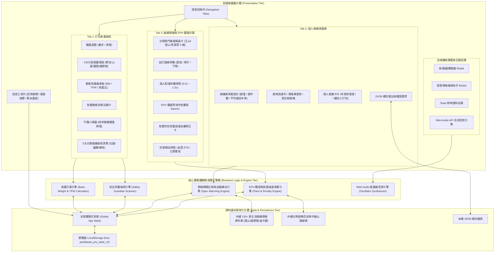
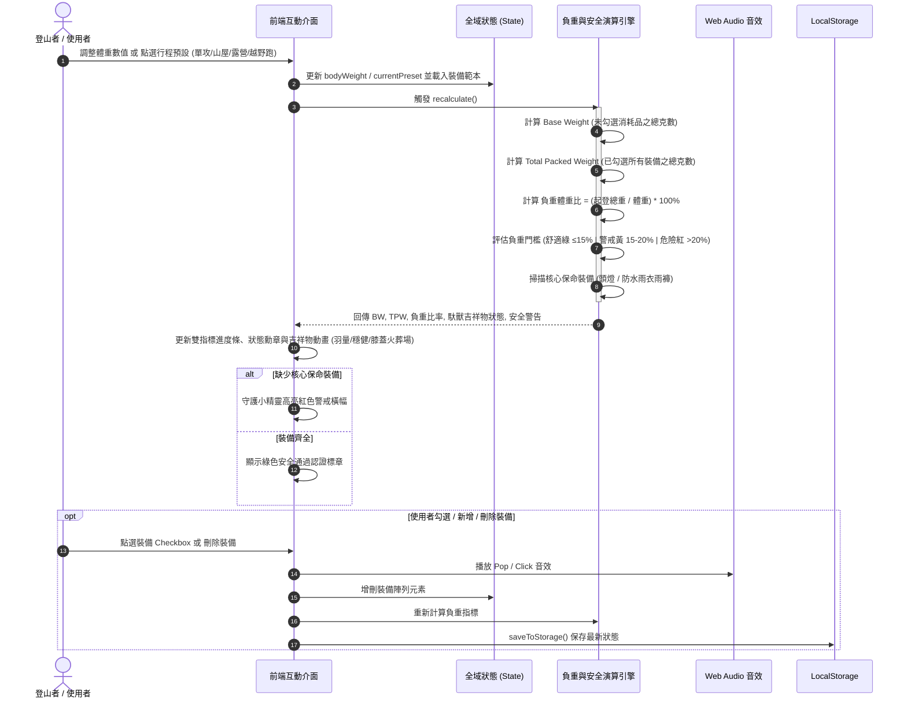
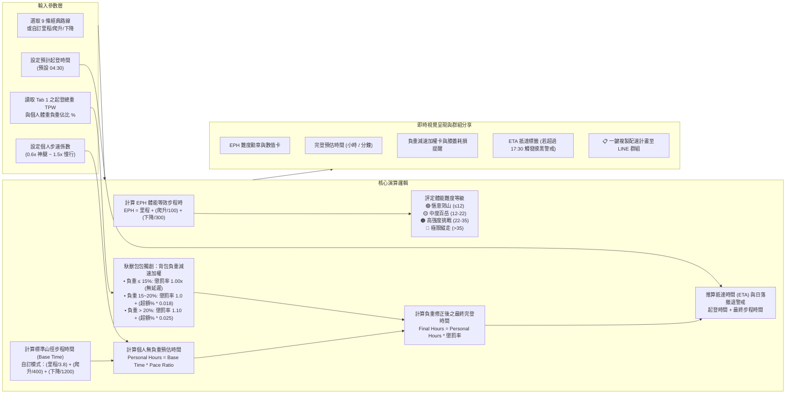
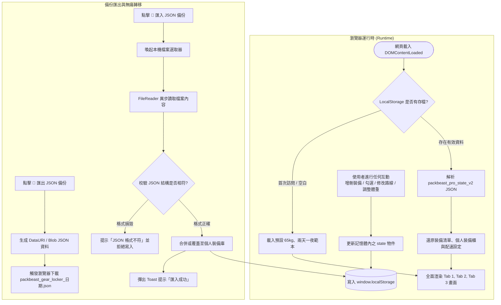

# 《山岳馱獸包包 PackBeast Pro》系統架構與運作流程圖說明書

本文件詳細闡述《山岳馱獸包包 PackBeast Pro》的軟體系統架構、元件分層、模組交互關係以及四大核心功能的運作流程圖（採用 Mermaid 語法繪製）。

---

## 🏗️ 一、系統總體分層架構圖 (System Architecture)

《山岳馱獸包包》採用**純前端單一靜態架構（Single Static SPA）**，無需任何伺服器端或構建工具即可在瀏覽器獨立運作，所有資料與運算皆在客戶端完成，兼具隱私優先、離線可用與零延遲反應特性。



---

## 🔄 二、核心功能運作流程圖 (Operational Workflows)

### 1. 打包負重檢核與動態儀表板運作流程 (Pack Check & Dynamic Dashboard)

此流程涵蓋登山者輸入體重、選擇行程型態範本、即時計算基礎重量（BW）與起登總重（TPW），並連動守護小精靈進行保命裝備掃描。



---

### 2. 裝備資產庫搜尋、規格庫智慧檢索與一鍵入庫流程 (Gear Locker & Spec Search)

本模組支援**離線毫秒級檢索**與**個人裝備壽命管理**，當使用者在裝備庫搜尋時，系統會同時比對個人既有裝備與 130+ 款官方規格庫。

```mermaid
flowchart TD
    Start([使用者在裝備庫搜尋框輸入關鍵字]) --> CheckInput{輸入文字是否為空?}
    
    CheckInput -- 是 --> ShowAllLocker[展示個人裝備庫完整清單與資產統計]
    
    CheckInput -- 否 --> QueryLocal[1. 檢索個人裝備庫 (Brand / Model / Notes / Category)]
    QueryLocal --> QueryDB[2. 同步檢索內建 130+ 官方規格庫 (登山/越野跑/迪卡儂)]
    
    QueryLocal & QueryDB --> FilterDuplicates{排除個人裝備庫已擁有的型號}
    
    FilterDuplicates --> RenderUI[動態渲染搜尋結果面板]
    
    RenderUI --> HasLocalMatch{個人庫有相符?}
    HasLocalMatch -- 有 --> DisplayLocalCards[展示個人裝備卡片 (含服役年資狀態燈號)]
    HasLocalMatch -- 無 --> DisplayEmptyPrompt[顯示個人庫未收錄提示]
    
    RenderUI --> HasDBMatch{官方規格庫有相符?}
    HasDBMatch -- 有 --> DisplayDBRecommendations[下方渲染 🌟 官方資料庫推薦區塊<br>標示品牌、官方淨重與分類]
    DisplayDBRecommendations --> ClickAdd[使用者點擊 ➕ 登記存入裝備庫]
    ClickAdd --> AutoFill[自動提取規格參數 (品牌/品名/克數/分類/當前啟用日期)]
    AutoFill --> SaveLocker[存入個人裝備庫 State.gearLocker]
    SaveLocker --> PlaySound[播放 Success 成功提示音效]
    PlaySound --> RefreshView[即時重新渲染裝備庫並持久化儲存]
    
    HasDBMatch -- 無 --> ShowExternalLink[顯示 🌐 Google 規格 / OutdoorGearLab 線上查詢按鈕]
    ShowExternalLink --> UserOnlineSearch[點擊開啟精準搜尋新分頁查閱克重]
```

---

### 3. 登山路線規格、EPH 體能指標與負重減速加權演算流程 (Route, EPH & Pack Penalty)

本功能整合路線地形指標與**打包總重（TPW）**，透過動態聯動演算法，真實模擬登山重裝對步速的減速影響。



---

### 4. 資料持久化、匯出備份與無痛轉移機制 (State Persistence & Backup)

保證使用者在離線、重新整理網頁或更換裝置時，裝備與計算狀態絕不遺失。



---

## 📊 三、核心資料結構規範 (Data Schema Reference)

### 1. 裝備項目物件（Gear Item Schema）
```typescript
interface GearItem {
  id: string;             // 唯一識別代碼 (如 "dh_1", "locker_1697...")
  brand: string;          // 品牌名稱 (如 "Montbell", "Arc'teryx", "Forclaz")
  name: string;           // 裝備品名與型號 (如 "Versalite Jacket 超輕風雨衣")
  cat: 'sleep' | 'warm' | 'cook' | 'safe' | 'gear'; // 裝備所屬五大系統
  grams: number;          // 裝備實秤重量（公克 g）
  checked?: boolean;      // 打包檢核勾選狀態 (true = 已裝入背包)
  isConsumable: boolean;  // 是否為消耗品 (水、糧食、瓦斯，不計入 Base Weight)
  vital: boolean;         // 是否為保命裝備 (頭燈、雨衣雨褲)
  vitalType?: 'headlamp' | 'rain' | null; // 保命裝備特定類型
  startDate?: string;     // 啟用日期 (YYYY-MM-DD，用於裝備庫計算服役年資)
  notes?: string;         // 個人使用心得或保養備註
}
```

### 2. 路線參數物件（Route Parameter Schema）
```typescript
interface RouteItem {
  id: string;             // 路線代碼 (如 "yushan_main", "custom")
  name: string;           // 路線名稱 (如 "玉山主峰線 (塔塔加往返)")
  distKm: number;         // 總單程或往返里程 (公里 km)
  ascentM: number;        // 累計爬升高度 (公尺 m)
  descentM: number;       // 累計下降高度 (公尺 m)
  standardHours: number;  // 路線標準地圖步程基準時間 (小時 hr)
  desc: string;           // 路線地形特徵與安全提示說明
}
```

---

## 💡 四、架構特點與工程優勢總結

1. **零外部框架依賴（Zero Dependencies）**：純原生 HTML5、CSS3 與現代 ES6+ JavaScript，整套系統打包於單一檔案，無 npm 套件龐大體積與供應鏈漏洞風險。
2. **高響應式與流暢體驗（60 FPS Animation）**：採用 CSS 變數系統、彈性格線（Flexbox/Grid）與硬體加速過渡效果，支援手機、平板至桌上型螢幕無縫適配。
3. **離線優先設計（Offline-First & Local-First）**：內建 130+ 款裝備與 9 條路線資料，在無行動網路的山區仍可完整運行所有檢核、搜尋與計算功能。
4. **模組化演算法解耦（Decoupled Calculation Engines）**：負重引擎、守護掃描器、規格檢索器與配速引擎各自獨立，便於未來擴充 GPS GPX 軌跡匯入或天氣預報 API 串接。
