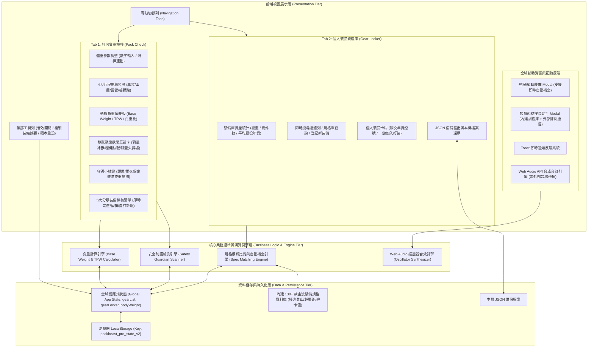
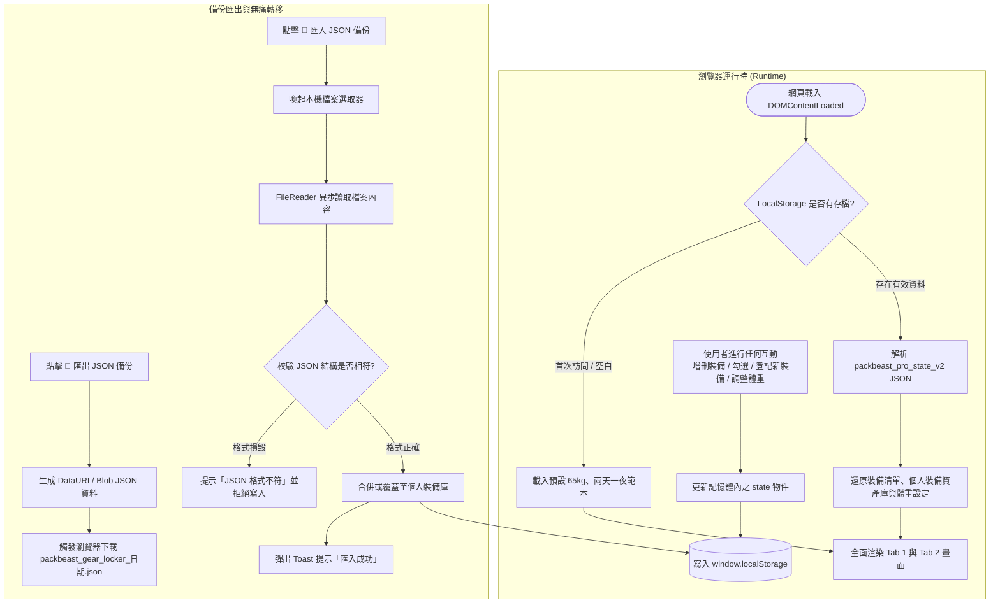

# 《山岳馱獸包包 PackBeast Pro》系統架構與運作流程圖說明書

本文件詳細闡述《山岳馱獸包包 PackBeast Pro》的軟體系統架構、元件分層、模組交互關係以及核心功能的運作流程圖（採用 Mermaid 語法繪製）。

---

## 🏗️ 一、系統總體分層架構圖 (System Architecture)

《山岳馱獸包包》採用**純前端單一靜態架構（Single Static SPA）**，無需任何後端伺服器或建置工具即可在瀏覽器獨立運作，所有運算與資料儲存皆在使用者客戶端完成，具備離線可用、極速響應與隱私安全特性。



---

## 🔄 二、核心功能運作流程圖 (Operational Workflows)

### 1. 打包負重檢核與動態儀表板運作流程 (Pack Check & Dynamic Dashboard)

此流程涵蓋登山者設定體重、選取行程型態預設範本、即時計算基礎重量（Base Weight）與起登總重（Total Packed Weight），並連動守護小精靈進行保命裝備即時掃描。


---

### 2. 裝備資產庫搜尋、規格庫智慧檢索與一鍵入庫流程 (Gear Locker & Spec Search)

本模組支援**離線毫秒級雙向檢索**與**個人裝備壽命管理**，當使用者在裝備庫搜尋時，系統會同時檢索個人既有裝備與 130+ 款官方規格庫。

```mermaid
flowchart TD
    Start([使用者在裝備庫搜尋框輸入關鍵字]) --> CheckInput{輸入文字是否為空?}
    
    CheckInput -- 是 --> ShowAllLocker[展示個人裝備庫完整清單與資產統計]
    
    CheckInput -- 否 --> QueryLocal[1. 檢索個人裝備庫 (Brand / Model / Notes / Category)]
    QueryLocal --> QueryDB[2. 同步檢索內建 130+ 官方規格庫 (登山/越野跑/迪卡儂)]
    
    QueryLocal & QueryDB --> FilterDuplicates{排除個人裝備庫已擁有的型號}
    
    FilterDuplicates --> RenderUI[動態渲染搜尋結果面板]
    
    RenderUI --> HasLocalMatch{個人庫有相符?}
    HasLocalMatch -- 有 --> DisplayLocalCards[展示個人裝備卡片 (含服役年資狀態燈號)]
    HasLocalMatch -- 無 --> DisplayEmptyPrompt[顯示個人庫未收錄提示]
    
    RenderUI --> HasDBMatch{官方規格庫有相符?}
    HasDBMatch -- 有 --> DisplayDBRecommendations[下方渲染 🌟 官方資料庫推薦區塊<br>標示品牌、官方淨重與分類]
    DisplayDBRecommendations --> ClickAdd[使用者點擊 ➕ 登記存入裝備庫]
    ClickAdd --> AutoFill[自動提取規格參數 (品牌/品名/克數/分類/啟用日期)]
    AutoFill --> SaveLocker[存入個人裝備庫 State.gearLocker]
    SaveLocker --> PlaySound[播放 Success 成功提示音效]
    PlaySound --> RefreshView[即時重新渲染裝備庫並持久化儲存]
    
    HasDBMatch -- 無 --> ShowExternalLink[顯示 🌐 Google 規格 / OutdoorGearLab 線上查詢按鈕]
    ShowExternalLink --> UserOnlineSearch[點擊開啟精準搜尋新分頁查閱克重]
```

---

### 3. 資料持久化、匯出備份與無痛轉移機制 (State Persistence & Backup)

確保使用者在離線、重新整理網頁或更換不同裝置時，個人裝備資產與打包狀態安全無虞。



---

## 📊 三、核心資料結構規範 (Data Schema Reference)

### 裝備項目物件（Gear Item Schema）
```typescript
interface GearItem {
  id: string;             // 唯一識別代碼 (如 "dh_1", "locker_1697...")
  brand: string;          // 品牌名稱 (如 "Montbell", "Arc'teryx", "Forclaz")
  name: string;           // 裝備品名與型號 (如 "Versalite Jacket 超輕風雨衣")
  cat: 'sleep' | 'warm' | 'cook' | 'safe' | 'gear'; // 裝備所屬五大系統
  grams: number;          // 裝備實秤重量（公克 g）
  checked?: boolean;      // 打包檢核勾選狀態 (true = 已裝入背包)
  isConsumable: boolean;  // 是否為消耗品 (水、糧食、瓦斯，不計入 Base Weight)
  vital: boolean;         // 是否為保命裝備 (頭燈、雨衣雨褲)
  vitalType?: 'headlamp' | 'rain' | null; // 保命裝備特定類型
  startDate?: string;     // 啟用日期 (YYYY-MM-DD，用於裝備庫計算服役年資)
  notes?: string;         // 個人使用心得或保養備註
}
```

---

## 💡 四、架構特點與工程優勢總結

1. **聚焦核心體驗**：全面專注於「輕量化負重控制」與「個人裝備生命週期管理」兩大核心價值，介面直覺乾淨，無冗餘干擾。
2. **零外部框架依賴（Zero Dependencies）**：純原生 HTML5、CSS3 與現代 JavaScript（ES6+），單一靜態檔案架構，可直接部署於 GitHub Pages。
3. **離線優先設計（Offline-First & Local-First）**：內建 130+ 款主流裝備規格資料庫，在無行動網路的山區仍可完整運行所有檢核、搜尋與裝備管理功能。
4. **流暢動態回饋（60 FPS Animation）**：CSS 變數系統、彈性感應格線與硬體加速過渡動畫，在手機、平板與桌機上均能享有極致體驗。
