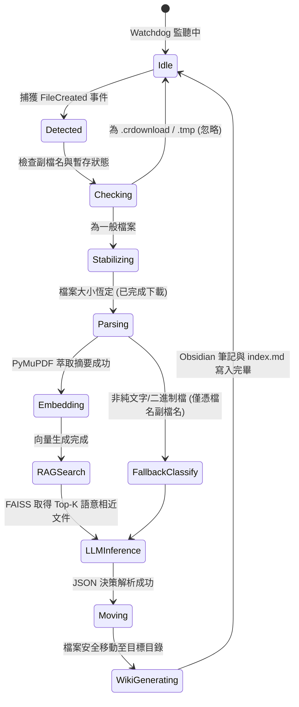

# 系統架構與技術規格說明書 (ARCHITECTURE.md)

> **專案名稱**：本地 RAG 檔案管家與自動知識庫 (Local AI File Agent)  
> **課程**：國立臺灣科技大學 115-1 智慧虛擬實境與人工智慧 (TAICA_IVEAI) 期末專案  
> **作者**：林宸平 (M11552010)

---

## 🏛️ 1. 系統整體架構 (System Architecture)

本專案採用 **事件驅動 (Event-Driven)** 與 **微核心管線 (Pipeline Architecture)** 設計，由以下六大模組協同運作：

```mermaid
flowchart TD
    subgraph S1["1. 感知層 (Perception Layer)"]
        A["macOS ~/Downloads"] -->|"FSEvents 變更"| B["Python Watchdog Observer"]
        B -->|"防抖動 (Debounce 1.5s)"| C["File Lock Validator"]
        C -->|"過濾 .crdownload / .tmp"| D["Raw File Ready"]
    end

    subgraph S2["2. 解析與特徵層 (Parsing & Embedding)"]
        D --> E["MIME Detector (python-magic)"]
        E --> F["Text Extractor (PyMuPDF / docx / txt)"]
        F -->|"Token 截斷保護 (前 5 頁 + Conclusion)"| G["Sanitized Chunk"]
        G --> H["Ollama nomic-embed-text"]
        H -->|"768-dim Vector"| I["Query Vector"]
    end

    subgraph S3["3. 檢索與記憶層 (RAG Semantic Memory)"]
        I --> J["FAISS Vector Index"]
        J -->|"Cosine Similarity Top-3"| K["Context 文獻與過往分類特徵"]
    end

    subgraph S4["4. 決策層 (Agent Reasoning Layer)"]
        G & K --> L["Prompt Template (分類規則 + JSON Schema)"]
        L --> M["Ollama Qwen 2.5 Coder 7B"]
        M -->|"嚴格 JSON 輸出驗證"| N["Action Decision Object"]
    end

    subgraph S5["5. 執行與歸檔層 (Execution & Wiki Layer)"]
        N --> O["File Mover (安全搬移 + 衝突重命名)"]
        N --> P["Wiki Note Generator"]
        P --> Q["Obsidian Vault Markdown 筆記"]
        Q --> R["更新 index.md (知識總表) & log.md (審計日誌)"]
    end

    style S1 fill:#0f172a,stroke:#38bdf8,stroke-width:1px
    style S2 fill:#064e3b,stroke:#10b981,stroke-width:1px
    style S3 fill:#1e1b4b,stroke:#818cf8,stroke-width:1px
    style S4 fill:#312e81,stroke:#a855f7,stroke-width:1px
    style S5 fill:#14532d,stroke:#22c55e,stroke-width:1px
```

---

## 🔄 2. 核心管線與狀態機 (State Machine)

檔案從進入下載資料夾到完成歸檔之生命週期：

---

## 📦 3. 模組職責劃分 (Module Responsibilities)

| 模組路徑 | 核心職責 | 關鍵依賴 |
| :--- | :--- | :--- |
| `main.py` | 程式進入點、CLI 參數解析 (`--dry-run`, `--vault`)、Watchdog 守護行程生命週期管理 | `argparse`, `watchdog` |
| `config.yaml` | 系統設定檔：路徑、Ollama 連線參數、預設分類規則、排除清單 | `pyyaml` |
| `agent/llm_caller.py` | 與本地 Ollama 服務進行 HTTP API 交互，解析並修復 JSON 輸出 | `urllib3` / `requests`, `json` |
| `agent/rag_engine.py` | 管理本地 FAISS 向量資料庫，執行增量 Embedding 索引與 Top-K 餘弦檢索 | `faiss-cpu`, `numpy` |
| `agent/prompt_template.py` | 規範 System Prompt、分類階層、雙向連結格式與少樣本範例 (Few-Shot) | 純 Python 模板 |
| `utils/file_parser.py` | 多格式檔案內容解析 (PDF/DOCX/TXT/MD)，提供安全長度截斷防爆 Token | `fitz` (PyMuPDF), `python-docx` |
| `utils/file_mover.py` | 具備衝突避讓命名、路徑自動建立與 Dry-run 模擬之檔案搬移器 | `pathlib`, `shutil` |
| `utils/wiki_builder.py` | 依照 Obsidian 規範產生具 YAML Frontmatter 與雙向連結之 Markdown 筆記 | `datetime`, `re` |

---

## 🔒 4. 容錯與安全設計 (Defensive Design)

1. **檔案鎖定檢查 (File Lock Safety)**：
   * 現代瀏覽器在下載大檔案時會先建立空檔或持續寫入。系統在感知到事件後，會至少進行兩次相隔 1 秒之 `os.path.getsize` 比對，確認位元組不變且無寫入鎖定才釋放給解析器。
2. **同名衝突自動消解 (Collision Renaming)**：
   * 當目標目錄已存在同名檔案時，絕不執行強制覆蓋，而是以 `filename_YYYYMMDD_HHMMSS.ext` 命名。
3. **Token 限制與截斷 (Budget Guard)**：
   * 若遇到數百頁之教科書或論文，解析器僅取：
     * 第 1 頁（論文標題、作者、關鍵字）
     * 第 2~3 頁（Abstract、Introduction 核心）
     * 倒數 1~2 頁（Conclusion、Discussion）
   * 確保總輸入 Token 穩定控制在 2,000 以內，在 Qwen 2.5 Coder 7B 上達到毫秒級推理速度。
4. **離線純本地運行 (Zero Leakage)**：
   * 系統不向任何外部公有雲 API 發出請求，所有 Embedding 與 LLM 推論都在 localhost (`127.0.0.1:11434`) 執行。

