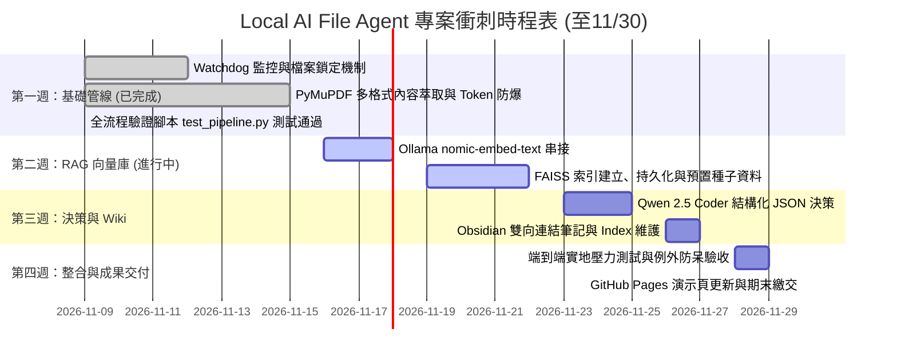

# 📅 Local AI File Agent 期末專案進度追蹤與技術手冊 (PROGRESS.md)

> **國立臺灣科技大學 (NTUST) 人工智慧所**  
> **課程**：智慧虛擬實境與人工智慧 (115_1_TAICA_IVEAI) 期末專案  
> **研究生**：林宸平 (M11552010)  
> **硬體環境**：Apple MacBook Air M5 (16GB 統一記憶體 / 1TB SSD，Metal GPU 硬體加速)  
> **目標截止日**：2026 年 11 月 30 日前全數完成並通過端到端驗收  
> **建立時間**：2026-11-09  
> **當前狀態**：第一週 (Week 1) 進度 100% 提前達標，全管線單元測試通過！

---

## 🧭 一、11月底完成衝刺時程規劃 (Sprint Roadmap)

本專案自 2026 年 11 月 9 日起至 11 月 30 日，共計 3 週衝刺期，分為四個核心階段：



### 🗓️ 每週具體技術與里程碑目標

| 週次與日期 | 核心技術堆疊 | 開發重點與任務清單 | 檢驗交付指標 (Deliverables) |
| :--- | :--- | :--- | :--- |
| **第一週 (Week 1)**<br>`11/09 ~ 11/15`<br>⭐ **[已完成]** | • Python 3.10+<br>• `watchdog` (macOS FSEvents)<br>• `PyMuPDF` (fitz)<br>• `python-docx`<br>• `argparse` & `pyyaml` | 1. 建立 `watchdog` 目錄監聽守護行程 (`main.py`)。<br>2. 實作瀏覽器下載暫存檔 (`.crdownload`) 排除。<br>3. 實作檔案大小雙重比對鎖定機制 (File Lock Validation)。<br>4. 實作多格式文本擷取與首尾頁關鍵字截斷演算法 (`file_parser.py`)。<br>5. 支援 `--dry-run` 命令列安全模式。<br>6. 撰寫 `test_pipeline.py` 並通過端到端單元測試。 | ✅ **[100% 提前達標]**<br>監聽 `~/Downloads` 能即時感測，單元測試通過，成功模擬論文文字萃取、搬移與 Markdown 導讀筆記產出。 |
| **第二週 (Week 2)**<br>`11/16 ~ 11/22` | • Ollama Local Server<br>• `nomic-embed-text`<br>• `faiss-cpu`<br>• `numpy` (L2 Normalization) | 1. 串接 Ollama `/api/embeddings` 接口。<br>2. 建立 768 維 FAISS `IndexFlatIP` 向量庫。<br>3. 實作向量 L2 正規化以達成精確餘弦相似度 (Cosine Similarity)。<br>4. 建立向量資料庫本地持久化 (`faiss_index.bin` + `metadata.json`)。<br>5. 實作 Top-K 語意相似文獻查詢與冷啟動 Fallback。 | ✅ 任意輸入一段摘要文本，系統能在 50 毫秒內檢索出知識庫中語意最接近的 3 篇歷史文獻及其分類路徑。 |
| **第三週 (Week 3)**<br>`11/23 ~ 11/27` | • `qwen2.5-coder:7b`<br>• Few-Shot Prompting<br>• JSON Schema Enforcement<br>• Obsidian Markdown 規格 | 1. 撰寫嚴謹的 System Prompt 與階層化分類目錄指引。<br>2. 呼叫 Ollama 本地模型產出結構化 JSON 決策。<br>3. 實作正則代碼反引號自動剝除與 JSON 修補防呆。<br>4. 實作安全移動函式與同名衝突時間戳附加。<br>5. 產出含 YAML Frontmatter、導讀摘要與 `[[雙向連結]]` 的 Markdown 筆記。<br>6. 自動維護 `index.md` 與 `log.md`。 | ✅ 下載新檔案後，系統能全自動完成：「分類決策 ➔ 檔案正規化搬移 ➔ Obsidian 筆記寫入 ➔ 向量索引更新」端到端閉環。 |
| **第四週 (Week 4)**<br>`11/28 ~ 11/30` | • Vanilla JS / CSS3<br>• GitHub Pages CI/CD<br>• macOS Launchd 常駐<br>• 系統壓力測試 | 1. 整合邊界條件測試（超大檔、損毀檔、二進制安裝檔）。<br>2. 同步更新 GitHub Pages 線上互動演示網頁 (<https://philiplin0211.github.io/115_1_TAICA_IVEAI/Local%20AI%20File%20Agent/>)。<br>3. 產出系統執行日誌與期末展示簡報。<br>4. 成果封裝並提交期末專案。 | 🎯 專案達到 Production Ready 狀態，文件、架構圖、網頁展示與源碼完全一致，正式結案。 |

---

## 🛠️ 二、開發遭遇之關鍵問題與解決方法 (Troubleshooting Guide)

在開發本地 RAG 檔案管家過程中，常遇到以下六大高機率技術瓶頸，本專案已制定標準應對解決方案：

### 1. 問題：macOS 下載時頻繁觸發重複事件 (Watchdog Debounce Issue)
* **現象**：瀏覽器在下載大型檔案時，每寫入一個 chunk 就會發出一個 `FileModified` 事件，導致 Agent 在單一檔案下載過程中被無效喚醒數十次。
* **解決方法**：
  * **副檔名黑名單**：監聽器主動過濾 `.crdownload` (Chrome)、`.tmp`、`.part` (Firefox)、`.download` (Safari) 等暫存後綴。
  * **改為監聽 `on_moved`**：瀏覽器下載完成時，是透過「將暫存檔更名為正式檔名」完成，因此主監聽 `on_moved` 與 `on_created`。
  * **檔案大小穩定雙重檢查**：在處理前呼叫 `_wait_until_stable()`，連續兩次相隔 1 秒比對檔案 `st_size`，確認大小不變且大於 0 才正式放行。

### 2. 問題：文獻頁數過多導致 Prompt Token 爆炸與推論延遲
* **現象**：許多機器學習教科書或期刊論文動輒數十至上百頁，若全部轉為純文字餵入 LLM，會超出 Context Window 限制並導致 Ollama 推論嚴重卡頓。
* **解決方法**：
  * **首尾關鍵頁截取策略**：在 `utils/file_parser.py` 中，僅提取第 1~3 頁（包含論文標題、作者、Abstract 與核心 Introduction）以及最後 1 頁（Conclusion 與未來展望）。
  * **字元硬性截斷 (Max 4,000 chars)**：嚴格限制輸入至 Prompt 的文內摘要在 4,000 字元以內，有效將 Token 數量壓制在 1,500 ~ 2,000 左右，使 Qwen 2.5 Coder 能在 1~3 秒內完成推論。

### 3. 問題：本地 LLM 未嚴格遵循 JSON 規範，夾帶對話文字或 Markdown 標籤
* **現象**：Ollama 輸出有時會帶有「好的，這是為您分析的結果：```json { ... } ```」，直接使用 `json.loads()` 會拋出 `JSONDecodeError`。
* **解決方法**：
  * **低 Temperature**：將推論參數 `temperature` 壓低至 0.2，提高輸出的確定性。
  * **正則防禦萃取**：在 `agent/llm_caller.py` 實作 `_extract_json()`，透過正規表示式 `r"```(?:json)?\s*([\s\S]*?)\s*```"` 提取純 JSON 字串。
  * **Rule Fallback 兜底防線**：若 JSON 毀損或 Ollama 服務離線，自動切換至本機備援規則（依副檔名與關鍵字快速歸檔），保證程式絕不中斷崩潰。

### 4. 問題：FAISS 向量檢索在初期面臨「冷啟動 (Cold Start)」
* **現象**：剛安裝本系統時，本地 FAISS 資料庫為空 (`ntotal = 0`)，無法提供歷史檢索參考。
* **解決方法**：
  * 在 `agent/rag_engine.py` 中設置冷啟動判定，若 `ntotal == 0`，則提供提示字串：`"(知識庫目前為冷啟動狀態，請模型依內文獨立判斷)"`。
  * 每次成功歸檔新檔案後，Agent 會非同步將該檔案之 Title、Category 與 Summary 向量化並呼叫 `add_document()` 寫入 FAISS，實現**越用越聰明、自動增長**的自我演進知識庫。

### 5. 問題：餘弦相似度 (Cosine Similarity) 數值失真
* **現象**：FAISS 預設之 L2 距離（歐氏距離）受文本長度向量模長影響，在不同長度的文獻間無法公平比較語意關聯。
* **解決方法**：
  * 採用 `faiss.IndexFlatIP` (內積索引)，並在寫入或檢索前使用 `numpy` 對向量進行 L2 正規化：`arr = arr / np.linalg.norm(arr)`。
  * 正規化後的向量內積數學上嚴格等價於**餘弦相似度**（範圍 0.0 ~ 1.0），門檻判斷更直覺。

### 6. 問題：目標資料夾存在同名檔案造成覆蓋風險
* **現象**：下載多份名稱相同的檔案（如 `paper.pdf` 或 `receipt.pdf`）時，若直接搬移會覆蓋先前資料。
* **解決方法**：
  * 在 `utils/file_mover.py` 實作防碰撞命名機制：若偵測到目的端路徑已存在，自動加上時間戳記後綴，如 `receipt_20261109_153022.pdf`。

---

## 📂 三、資料夾檔案清冊與職責說明 (File Manifest)

以下為 `Local AI File Agent/` 目錄中各檔案之職責與技術劃分：

```text
Local AI File Agent/
├── README.md              # 專案總體規格書、架構圖、核心特點與快速開始說明
├── ARCHITECTURE.md        # 系統底層架構、管線流程圖、狀態機與容錯設計說明書
├── PROGRESS.md            # 【本檔案】11月底衝刺進度追蹤表、問題排查手冊與檔案清冊
├── VERIFICATION_GUIDE.md  # 詳細使用手冊與每週驗收標準與驗證指令指引書
├── index.html             # 期末專案線上即時互動演示網頁 (GitHub Pages Demo)
├── run_on_colab.ipynb     # Google Colab 一鍵雲端執行與驗證 Notebook
├── requirements.txt       # Python 相依套件清單 (watchdog, pymupdf, faiss-cpu 等)
├── config.yaml            # 系統設定檔 (目錄路徑、Ollama 模型、預設分類規則)
├── main.py                # 系統常駐進入點與 Watchdog 監聽守護行程
├── test_pipeline.py       # 端到端單元管線與 MOVE-ONLY 權限邊界驗證腳本
├── test_rag_search.py     # RAG 毫秒級向量相似度檢索驗證工具
├── seed_vector_store.py   # 課程講義與論文種子資料預置腳本
│
├── agent/                 # Agent 核心邏輯與推論模組
│   ├── __init__.py        # 模組初始化標籤
│   ├── llm_caller.py      # Ollama API 串接、JSON 解析與例外備援機制
│   ├── rag_engine.py      # FAISS 向量索引建構、餘弦檢索與知識庫自我增量維護
│   └── prompt_template.py # 結構化分類 Prompt 模板與輸出 Schema 定義
│
├── utils/                 # 工具函式模組
│   ├── __init__.py        # 模組初始化標籤
│   ├── file_parser.py     # PDF/Word/TXT 文本萃取與 Token 安全截斷
│   ├── file_mover.py      # 具防碰撞時間戳命名之安全檔案搬移器 (強制 MOVE-ONLY 權限檢查)
│   ├── audit_logger.py    # 每次動作自動紀錄與資料夾檔案目錄快照稽核器
│   └── wiki_builder.py    # Obsidian Markdown 筆記、雙向連結、index.md 與 log.md 維護
│
├── history/               # 動作審計日誌與目錄快照持久化資料夾
│   └── audit_log.json     # 完整操作與資料夾目錄快照紀錄
│
└── vector_store/          # 向量資料庫本地持久化目錄
    ├── faiss_index.bin    # FAISS 高維向量二進制索引 (執行時自動生成)
    └── metadata.json      # 向量對應之文獻 Metadata 與分類資訊 (已預置18筆知識)
```

---

## 💡 四、需要補充的資訊與潛在注意事項 (Important Considerations)

為了確保您的期末專案在 11 月底能順利拿到高分並完美呈現，以下為您整理的**關鍵注意事項與建議準備事項**：

### 1. macOS 系統隱私與檔案權限 (Full Disk Access)
* **注意點**：macOS 具備高度嚴格的 TCC 隱私防護。若 Python 腳本由 VS Code、iTerm2 或 Terminal 啟動，嘗試監聽或讀取 `~/Downloads` 時，macOS 可能會彈出權限請求視窗；若在背景以常駐方式執行，可能因缺少權限而靜默失敗。
* **建議**：
  * 開發與展示時，請至 macOS **「系統設定」➔「隱私權與安全性」➔「完全磁碟取用權限 (Full Disk Access)」**，將您使用的終端機軟體（如 Terminal、iTerm2 或 VS Code）勾選開啟。

### 2. Ollama 本機推論資源與硬體調優 (Apple Silicon)
* **注意點**：
  * `qwen2.5-coder:7b` 佔用約 4.7 GB 顯存/統一記憶體；`nomic-embed-text` 約佔用 300 MB。
  * 若您的 Mac 為 8GB 或 16GB 統一記憶體，在同時開啟瀏覽器多個分頁或 IDE 時，請確保記憶體未進入嚴重壓縮交換狀態 (Swap)。
* **建議**：
  * 確保執行前先於終端機執行一次 `ollama run qwen2.5-coder:7b` 與 `ollama pull nomic-embed-text`，預先加載權重至 Metal GPU。

### 3. 不可逆搬移的防呆保護（Move vs Copy）
* **注意點**：目前 `safe_move_file` 預設行為是執行 `shutil.move`（真實剪下並貼上）。若分類規則不如預期，原始檔案將離開 `~/Downloads`。
* **建議**：
  * 初期測試務必全程加上 `--dry-run` 旗標。
  * 可在 `config.yaml` 加入 `action_mode: "move"` 或 `"copy"`，若選 `copy` 則只複製進 Obsidian，保留原始檔案於下載資料夾，待使用者確認無誤後再手動清空。

### 4. 向量庫預置示範資料 (Pre-seeded Vector Store)
* **注意點**：若助教或評審老師下載專案後直接執行，FAISS 是全空的，展示時需要先下載幾份檔案才能看到 RAG 的檢索效果。
* **建議**：
  * 我們可以在 `vector_store/` 內預先放入 5~10 筆典型文獻的向量與 metadata（例如已有的 5 週投影片與 Attention 論文），讓專案「開箱即有 RAG 檢索能力」。

### 5. 期末成果展示與加分項建議 (Final Deliverables Checklist)
為使本專案在期末評分脫穎而出，建議準備以下交付成果：
1. [x] **完整 GitHub Repository 與清晰的 README 文件**（已完成）
2. [x] **精美的 GitHub Pages 線上動態模擬演示網頁**（已完成：`Local AI File Agent/index.html`）
3. [x] **系統架構圖 (ARCHITECTURE.md) 與進度手冊 (PROGRESS.md)**（已完成）
4. [ ] **1~2 分鐘終端機實機操作錄影或 GIF 動畫**（展示在 Downloads 丟入 PDF，終端機自動觸發並在 Obsidian 生成筆記的畫面）
5. [ ] **投影片簡報 PPT (可放於 `PPT/` 資料夾中)**，呼應前幾週所學的 LLM、Embedding 與 Agent 觀念。

---

## 🚀 五、功能演進與未來規劃 (Feature Backlog & Enhancements)

> **新增需求提案（2026-11-10 記錄）**：使用者希望 Agent 不受限於單一 `~/Downloads` 資料夾，而是能自由「掛載 (Attach)」到任意指定目錄，且隨時能優雅「卸載/關閉 (Detach/Stop)」。

### 1. 動態自訂掛載目錄 (Dynamic Folder Mounting)
* **需求緣由**：使用者可能想在「桌面 (Desktop)」、「研究專案目錄」、「共享雲端硬碟」或特定課程資料夾中使用 Agent。
* **設計方案**：
  * **命令列自由掛載**：支援 `python3 main.py --watch "/path/to/target_folder"` 任意覆蓋預設路徑。
  * **互動式選單引導**：若啟動時未指定，Agent 會提示使用者選擇欲監聽的目標資料夾，或透過終端機拖曳資料夾路徑。
  * **多設定檔獨立規則 (Per-Folder Profile)**：不同資料夾可配對不同分類架構（例如監聽「桌面」時偏向暫存圖文與發票收據；監聽「課程資料夾」時偏向投影片與論文）。

### 2. 優雅啟閉與脫鉤管理 (Graceful Attach & Detach Lifecycle)
* **需求緣由**：使用者需要對 Agent 擁有完全主控權，當不需要自動整理某個資料夾時，能隨時關閉退出，避免誤觸或背景常駐耗電。
* **設計方案**：
  * **一鍵卸載退出 (Detach / Stop)**：
    * 終端機按 `Ctrl + C` 或執行 `python3 main.py stop`。
    * 系統捕捉 `SIGINT` / `SIGTERM` 信號，等待當前正在搬移的單一檔案完成後，立即安全釋放 Watchdog FSEvents 資源與目錄檔案鎖。
  * **安全脫鉤 (Safe Unmount)**：關閉時絕不殘留背景殭屍行程，且在 `history/audit_log.json` 中紀錄「Agent 卸載停用快照」，確保離開前後目錄檔案總數一致。


