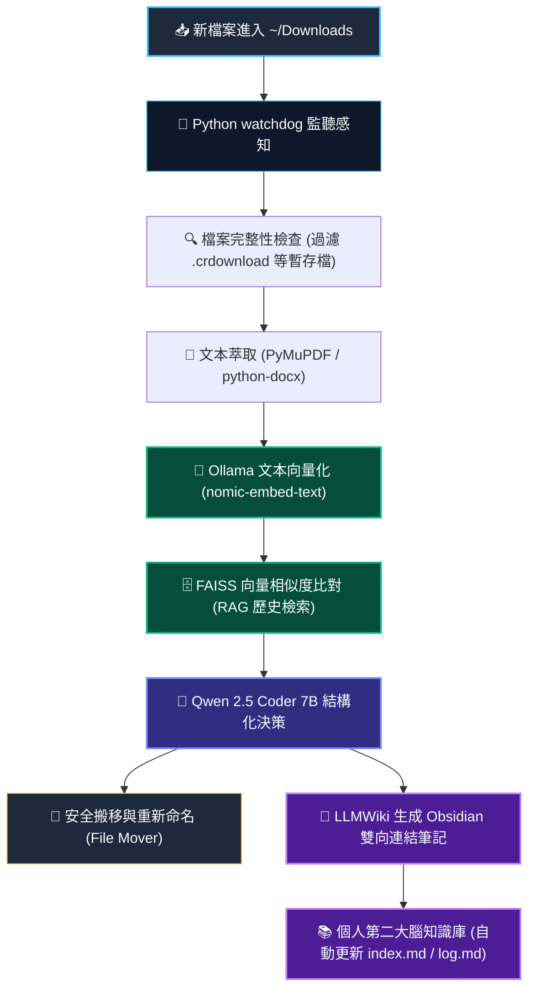

# 🧠 本地 RAG 檔案管家與自動知識庫 (Local AI File Agent)

> **國立臺灣科技大學 (NTUST) 人工智慧所**  
> **課程名稱**：智慧虛擬實境與人工智慧 (115_1_TAICA_IVEAI)  
> **專案類別**：學期期末專案 (Final Project)  
> **學號**：M11552010  
> **姓名**：林宸平  
> **專案主題**：基於 macOS 本地環境、Ollama 與 FAISS 的全自動下載檔案分類、向量檢索與 LLMWiki 個人第二大腦系統

[](https://philiplin0211.github.io/115_1_TAICA_IVEAI/Local%20AI%20File%20Agent/)
[](https://philiplin0211.github.io/115_1_TAICA_IVEAI/)
[](https://colab.research.google.com/github/PhilipLin0211/115_1_TAICA_IVEAI/blob/main/Local%20AI%20File%20Agent/run_on_colab.ipynb)
[](https://github.com/PhilipLin0211/115_1_TAICA_IVEAI)


---

## 📌 快速核心連結 (Project Links)

* 🌐 **期末專案 GitHub Pages 線上即時互動演示 (Live Simulator)**：  
  👉 **[https://philiplin0211.github.io/115_1_TAICA_IVEAI/Local%20AI%20File%20Agent/](https://philiplin0211.github.io/115_1_TAICA_IVEAI/Local%20AI%20File%20Agent/)**
* 📓 **Colab 一鍵雲端運行與 RAG 驗證 Notebook**：  
  👉 **[run_on_colab.ipynb](./run_on_colab.ipynb)**
* 📅 **11月底衝刺進度追蹤表與問題排查手冊 (Progress & Issues)**：  
  👉 **[PROGRESS.md](./PROGRESS.md)**
* 🏗️ **系統架構圖與狀態機規格說明書 (Architecture & State Machine)**：  
  👉 **[ARCHITECTURE.md](./ARCHITECTURE.md)**
* 🏠 **學期作業與專案導航總中心首頁**：  
  👉 **[https://philiplin0211.github.io/115_1_TAICA_IVEAI/](https://philiplin0211.github.io/115_1_TAICA_IVEAI/)**
* 💻 **GitHub 原始碼儲存庫（Repository）**：  
  👉 **[https://github.com/PhilipLin0211/115_1_TAICA_IVEAI](https://github.com/PhilipLin0211/115_1_TAICA_IVEAI)**

---

## 💡 專案簡介與動機 (Introduction & Motivation)

現代研究者、工程師與學生的電腦中，`~/Downloads` (下載資料夾) 往往是極度雜亂的「數位垃圾場」：
* 隨意下載的大量學術論文 (arXiv PDFs)、課程講義、技術規格書、收據報表散落一地。
* 檔案命名不直覺 (例如 `2401.00123v1.pdf` 或 `invoice_download_2026.pdf`)，隔週便遺忘其內容與用途。
* 傳統檔案分類軟體僅能根據「副檔名」或「檔案大小」進行粗暴歸檔，無法深入**語意理解 (Semantic Understanding)**。
* 依賴公有雲端 AI (如 ChatGPT API) 上傳機密文件或私人文獻，有隱私洩漏與成本考量。

**《本地 RAG 檔案管家與自動知識庫 (Local AI File Agent)》** 正是為解決此痛點而生。本專案將背景自動監聽、本地端大語言模型 (Ollama)、向量資料庫檢索增強生成 (RAG) 與 **LLMWiki** 筆記知識庫概念完美整合：
1. **零人工干預**：下載完成後即刻於背景自動解析。
2. **語意深度理解**：利用向量嵌入與本地 LLM 進行精準主題分類與智慧命名。
3. **無縫融入 Obsidian**：自動抽取重點生成雙向連結 Markdown 閱讀筆記，打造持續進化的「個人第二大腦」。
4. **100% 本地端運行**：徹底保障隱私，不耗費額外 API 費用。

---

## ✨ 核心亮點與功能特色 (Key Features)



1. **自動監聽與非同步喚醒 (Auto-Sorting Watchdog)**：
   * 背景監聽 macOS `~/Downloads` 目錄變更事件。
   * 自動過濾瀏覽器下載中的暫存檔（如 `.crdownload`, `.tmp`, `.part`），確保檔案完全寫入磁碟後才觸發 Agent。
2. **多格式文本萃取與 Metadata 解析 (Text Extraction)**：
   * 支援 PDF、Word (`.docx`)、純文字 (`.txt`)、Markdown (`.md`)、原始碼檔。
   * 運用 `PyMuPDF` (fitz) 高速擷取首頁、摘要與目錄結構，搭配 `python-magic` 嚴謹判斷 MIME 格式，防止副檔名偽裝。
3. **RAG 向量知識庫比對 (Vector Retrieval)**：
   * 透過 Ollama `nomic-embed-text` 生成 768 維語意向量。
   * 進入本地輕量級向量庫 `FAISS` 進行餘弦相似度 (Cosine Similarity) 檢索，比對知識庫內現存文獻，判斷最匹配之分類目錄。
4. **本地 LLM 結構化推理決策 (Structured Agent Reasoning)**：
   * 搭載 `qwen2.5-coder:7b` (或 Llama 3)，具備卓越的嚴格 JSON 格式輸出與條件推理能力。
   * Agent 自動輸出具體行動方針：包括目標路徑、正規化命名、語意標籤與重要度評分。
5. **LLMWiki 個人知識庫建構 (Obsidian Integration)**：
   * 借鑑 LLMWiki 概念，自動在 Obsidian 筆記庫中產出對應閱讀筆記。
   * 筆記包含 YAML Frontmatter 中繼資料、核心重點摘要、以及 Obsidian 核心語法 `[[雙向連結]]` 與 `#標籤`，自動維護總目錄 `index.md` 與歷程紀錄 `log.md`。
6. **極致隱私與離線運作 (100% Local & Zero Cost)**：
   * 所有文本分析、Embedding 與模型推論均在本地 Mac 晶片 (Apple Silicon / Metal) 完成，免聯網、免 Token 計費、零個資外洩風險。
7. **嚴格最小權限防護 (MOVE-Only Permission Boundary)**：
   * 遵循「最小權限原則 (Principle of Least Privilege)」，系統底層硬性限定 Agent **僅有移動檔案 (MOVE) 權限**。
   * 絕無刪除 (DELETE)、覆寫 (OVERWRITE)、竄改檔案內容 (MODIFY) 或執行代碼之權限，杜絕誤刪或安全性破壞風險。
8. **每次動作完整紀錄與資料夾目錄快照 (Audit History & Directory Snapshots)**：
   * 每次觸發搬移時，自動在 `history/audit_log.json` 與 Obsidian `log.md` 寫入審計條目。
   * 同步記錄該次動作當下「來源下載資料夾」與「目標分類資料夾」的完整**檔案目錄快照 (Directory Snapshot)**，供隨時追溯與回溯。

---

## 🛠️ 技術堆疊 (Tech Stack)

| 領域層次 | 採用技術 / 工具 | 說明與選型優勢 |
| :--- | :--- | :--- |
| **本地推論引擎** | **Ollama** | 輕量高效率的本地模型伺服器，支援 macOS Metal 硬體加速 |
| **大語言模型** | **Qwen 2.5 Coder 7B** / Llama 3 | 代碼與 JSON 結構化解析力強大，能穩定遵循 Schema 產生決策 |
| **向量嵌入模型** | **nomic-embed-text** / BGE-M3 | 高效 768 維度文本嵌入模型，具備長文本語意表徵優勢 |
| **向量資料庫** | **FAISS (CPU/Metal)** | Facebook AI 本地高維度向量檢索庫，零服務負擔、毫秒級比對 |
| **檔案系統監聽** | **Python `watchdog`** | 基於 macOS FSEvents 的低功耗事件通知機制 |
| **文件內容萃取** | **`PyMuPDF` (fitz)**, `python-docx` | 高速解析 PDF 文本、元數據、章節段落 |
| **Agent 編排框架** | **LangChain** / LlamaIndex | 向量化索引建構、Prompt 模板、Agent Tool 路由調用 |
| **知識管理生態** | **Obsidian (Markdown LLMWiki)** | 本地純文字 Markdown 庫，支援雙向圖譜網路與離線搜尋 |

---

## 🏗️ 系統資料流與運作機制 (System Data Flow)

```text
[使用者下載檔案] 
       │
       ▼
1. Raw Stage (感知與擷取)
   - watchdog 捕獲 FileCreated / FileModified 事件
   - 檢查檔案大小穩定，確認非暫存檔
   - PyMuPDF 讀取前 3~5 頁與摘要區塊，生成 Chunk 摘要
       │
       ▼
2. RAG Stage (檢索與比對)
   - 將文本摘要透過 Ollama 轉為 Embedding 向量
   - FAISS 執行 Top-K 向量相似度搜尋
   - 找出知識庫中既有的語意相近文獻與既定分類規則
       │
       ▼
3. Agent Stage (決策與結構化輸出)
   - 整合 [新文件摘要] + [RAG 相似文獻特徵] + [既有分類目錄樹]
   - 由 Qwen 2.5 Coder 7B 產出 JSON 決策
       │
       ▼
4. Wiki Stage (歸檔與第二大腦建置)
   - 安全移轉檔案至目標分類資料夾 (例：~/Obsidian_Vault/AI_Research/NLP/)
   - 自動在 Obsidian 內產出「檔案摘要與導讀筆記.md」
   - 在主目錄 index.md 補充雙向連結與標籤索引
```

---

## 💻 決策 Schema 與範例 (Decision Schema Example)

Agent 所輸出的決策遵循嚴格的 JSON 格式規範：

```json
{
  "source_file": "attention_is_all_you_need.pdf",
  "sanitized_name": "2017_Vaswani_Attention_Is_All_You_Need.pdf",
  "category": "AI_Research/NLP",
  "destination_dir": "~/Obsidian_Vault/AI_Papers/NLP/",
  "tags": ["NLP", "Transformer", "Attention", "DeepLearning"],
  "summary": "介紹 Transformer 架構之經典論文，屏棄循環神經網絡與卷積，全基於 Self-Attention 機制達成 SOTA 翻譯成果。",
  "importance": "high",
  "wiki_note": {
    "title": "Vaswani et al. (2017) Attention Is All You Need",
    "linked_concepts": ["[[Transformer]]", "[[Self-Attention]]", "[[Sequence Modeling]]"],
    "action_required": "加入精讀清單並記錄於 [[Reading_List_2026]]"
  }
}
```

---

## 🚀 快速開始與環境建置 (Quick Start)

### 1. 建立 Python 虛擬環境
```bash
# 建立 conda 虛擬環境
conda create -n local_file_agent python=3.10 -y
conda activate local_file_agent

# 安裝核心依賴
pip install watchdog pymupdf python-docx langchain langchain-community faiss-cpu python-magic
```

### 2. 啟動 Ollama 並下載必備模型
```bash
# 確保 Ollama 已於本地啟動
ollama run qwen2.5-coder:7b
ollama pull nomic-embed-text
```

### 3. 專案目錄結構
```text
Local AI File Agent/
├── README.md              # 專案規格說明文件 (本檔)
├── index.html             # 期末專案互動演示網頁 (GitHub Pages Demo)
├── main.py                # 系統常駐進入點與 Watchdog 監聽設定
├── config.yaml            # 目標資料夾、Obsidian Vault 路徑設定
├── agent/
│   ├── __init__.py
│   ├── llm_caller.py      # Ollama API 接口封裝與 JSON 解析
│   ├── rag_engine.py      # FAISS 向量索引建立與檢索器
│   └── prompt_template.py # 智慧分類與摘要生成 Prompt
├── utils/
│   ├── __init__.py
│   ├── file_parser.py     # PDF/Word/TXT 內容擷取與長度截斷
│   ├── file_mover.py      # 具防覆蓋防呆機制的檔案搬移函式
│   └── wiki_builder.py    # Obsidian Markdown 筆記與 Index 維護器
└── vector_store/          # FAISS 本地持久化索引目錄
```

### 4. 執行與測試
```bash
# 測試模式 (Dry-run：僅輸出分類日誌，不執行檔案真實搬移)
python main.py --dry-run

# 正式常駐執行
python main.py --vault ~/Documents/Obsidian_Vault
```

---

## ⚠️ 開發防呆與工程注意事項 (Engineering Best Practices)

1. **Token 預算控管**：
   * 百頁文獻切忌整份丟入 LLM Prompt。系統在 `file_parser.py` 嚴格限制提取前 3~5 頁（含 Title, Abstract, Introduction）以及文末 Conclusion，有效將 Token 控制在 2,000 以內。
2. **檔案寫入鎖定機制 (File Lock Detection)**：
   * 瀏覽器下載大型檔案時會持續寫入，若太早讀取將造成例外或毀損。程式透過定時比對檔案大小 (`os.path.getsize`) 達 1.5 秒恆定才進行後續處理。
3. **Dry-Run 驗證模式**：
   * 首次部署時強制支援 `--dry-run` 旗標，僅於終端機列印搬移動作與 Markdown 預覽，防範誤搬重要資料。
4. **衝突重新命名防呆 (Collision Handling)**：
   * 若目的端已存在同名檔案，自動採用時間戳記附加尾碼 (如 `_20261109_1.pdf`)，絕不覆蓋任何既有資料。

---

## 💡 需要補充的資訊與潛在注意事項 (Important Considerations & Checklist)

為了確保專案在 11 月底評分與實地展示順利，請特別留意以下事項：

1. **macOS 權限設定（完全磁碟取用權限 Full Disk Access）**：
   * macOS 預設限制軟體讀取 `~/Downloads`。若透過背景守護行程監聽，請務必至 **「系統設定」➔「隱私權與安全性」➔「完全磁碟取用權限」**，將執行的終端機軟體（如 Terminal、iTerm2 或 VS Code）勾選允許，避免監聽事件被靜默阻擋。
2. **Ollama 本機顯存與 Metal 加速狀態**：
   * 確保執行前已下載好模型：`ollama run qwen2.5-coder:7b` 與 `ollama pull nomic-embed-text`。若使用 8GB/16GB 記憶體 Mac，請避免開啟過多高負載分頁，確保推論在 Apple Silicon 統一記憶體中保持 Metal GPU 硬體加速。
3. **搬移防呆（Move vs Copy 模式）**：
   * 系統預設採用 `shutil.move`（實體搬移），初期實測建議務必加上 `--dry-run`；若希望保留下載資料夾的原始檔案，可在 `config.yaml` 切換為複製（Copy）模式，以確保個人原始檔案不受影響。
4. **向量庫冷啟動與預置示範資料 (Pre-seeded Index)**：
   * 全新部署時 FAISS 為空。建議可將本學期已發布之課堂講義（如 01~08 週講義）預先執行向量化放入 `vector_store/`，使系統一開箱即具備成熟的 RAG 檢索比對能力。
5. **期末展示加分項**：
   * 建議在成果發表前錄製一段 **30~60 秒的實機操作 GIF/影片**，展示從瀏覽器下載檔案到 Obsidian 自動彈出具備雙向連結筆記的端到端過程。

---

> **國立臺灣科技大學 (NTUST) 人工智慧所**  
> 智慧虛擬實境與人工智慧 (115_1_TAICA_IVEAI) 期末專案  
> 研究生：林宸平 (M11552010)
