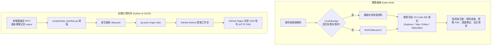

# 115-1 生成式AI：文字與圖像生成的原理與實務 課程作業集

> **國立臺灣科技大學 (NTUST) 人工智慧所**  
> **學號**：M11552010  
> **姓名**：林宸平  
> **GitHub 儲存庫**：[https://github.com/PhilipLin0211/115_1_TAICA_IVEAI](https://github.com/PhilipLin0211/115_1_TAICA_IVEAI)  
> **GitHub Pages 線上作業總覽中心**：👉 **[https://philiplin0211.github.io/115_1_TAICA_IVEAI/](https://philiplin0211.github.io/115_1_TAICA_IVEAI/)**

[](https://philiplin0211.github.io/115_1_TAICA_IVEAI/)
[](https://github.com/PhilipLin0211/115_1_TAICA_IVEAI)


---

## 📚 課程作業列表 (Course Assignments)

| 作業編號 | 作業名稱 / 主題 | 專案成品 | 線上體驗與文件連結 | 狀態 |
| :--- | :--- | :--- | :--- | :--- | :---: |
| **作業一 (HW 1)** | **用 Vibe Coding 做出一個互動網頁** | **《山岳馱獸包包 PackBeast Pro》**<br>登山輕量化負重與打包檢核 Web App | 🌐 [線上即時操作 (Live Demo)](https://philiplin0211.github.io/115_1_TAICA_IVEAI/%E7%94%A8%20Vibe%20Coding%20%E5%81%9A%E5%87%BA%E4%B8%80%E5%80%8B%E4%BA%92%E5%8B%95%E7%B6%B2%E9%A0%81/)<br>📖 [作業規格與開發歷程](./用%20Vibe%20Coding%20做出一個互動網頁/README.md)<br>🏗️ [系統架構圖 (Architecture)](./用%20Vibe%20Coding%20做出一個互動網頁/ARCHITECTURE.md)<br>📓 [Colab 雲端執行](./用%20Vibe%20Coding%20做出一個互動網頁/run_on_colab.ipynb) | ✅ 已發布 |
| **作業二 (HW 2)** | **建立一個自己的 AGENTS.md** | **《VS Code Dark+ 課程作業管理中樞》**<br>零透明度實色 IDE 風格入口 + 資料驅動管理 + 快速搜尋 + 本機 LocalStorage 暫存 + CI/CD 自動化 | 🌐 [線上即時操作 (Live Demo)](https://philiplin0211.github.io/115_1_TAICA_IVEAI/)<br>📖 [AGENTS.md 規範手冊](./AGENTS.md)<br>🏗️ [作業二系統架構書 (ARCHITECTURE)](./建立一個自己的%20%20AGENTS/README.md)<br>📝 [W08 自動化架構筆記](./notes/W08_AGENTS_md_設計筆記.md)<br>📂 [作業二規格專案目錄](./建立一個自己的%20%20AGENTS/) | ✅ 已發布 (🌟 全站中樞) |
| **作業三 (HW 3)** | **用 LLM Wiki 做一份教學 HTML 簡報** | **《AI Agents 是什麼？零基礎搞懂自主型代理人互動教學簡報》**<br>5 篇文獻 LLM Wiki 知識庫 + 10 頁式互動 HTML 教學簡報 + 雙向連結 | 🌐 [線上簡報 (GitHub Pages)](https://PhilipLin0211.github.io/llm-wiki-vae-diffusion/)<br>🌐 [課程主頁內嵌預覽](https://philiplin0211.github.io/115_1_TAICA_IVEAI/%E7%94%A8%20LLM%20Wiki%20%E5%81%9A%E4%B8%80%E4%BB%BD%E6%95%99%E5%AD%B8%20HTML%20%E7%B0%A1%E5%A0%B1/)<br>📖 [獨立 GitHub 倉庫](https://github.com/PhilipLin0211/llm-wiki-vae-diffusion)<br>📚 [LLM Wiki 知識庫](https://PhilipLin0211.github.io/llm-wiki-vae-diffusion/wiki/index.md)<br>📂 [作業三專案目錄](./用%20LLM%20Wiki%20做一份教學%20HTML%20簡報/) | ✅ 已發布 |
| **期末專案 (Final Project)** | **本地 RAG 檔案管家與自動知識庫** | **《Local AI File Agent》**<br>macOS 下載目錄自動化管家 + 向量檢索 + Obsidian LLMWiki 自動筆記 | 🌐 [線上即時操作 (Live Demo)](https://philiplin0211.github.io/115_1_TAICA_IVEAI/Local%20AI%20File%20Agent/)<br>📖 [專案架構與技術文件](./Local%20AI%20File%20Agent/README.md)<br>🧪 [詳細使用與驗收指引書](./Local%20AI%20File%20Agent/VERIFICATION_GUIDE.md)<br>📅 [11月底進度追蹤與問題手冊](./Local%20AI%20File%20Agent/PROGRESS.md)<br>🏗️ [系統架構規格書](./Local%20AI%20File%20Agent/ARCHITECTURE.md)<br>📓 [Colab 雲端執行](./Local%20AI%20File%20Agent/run_on_colab.ipynb)<br>📂 [原始碼目錄](./Local%20AI%20File%20Agent/) | ✅ 已發布 (⭐ 100% 驗收結案) |

---

## 🗂️ 儲存庫目錄結構 (Repository Structure)

為利於本學期多項作業的長期維護與收錄，本儲存庫採用**模組化作業子資料夾架構**，根目錄作為 GitHub Pages 課程作業入口，各次作業獨立收錄於各自的資料夾中：

```text
115_1_TAICA_IVEAI/
├── index.html                               # 課程作業線上導覽總頁 (VS Code Dark+ IDE 風格入口)
├── AGENTS.md                                # 專案架構、設計系統規範與 AI Agent 開發守則
├── data.json                                # 課程專案、講義、筆記與影片中繼資料庫 (Manifest)
├── README.md                                # 全學期作業目錄與儲存庫說明
├── scripts/                                 # 自動化建置腳本
│   └── build_manifest.py                    # 掃描資料夾並自動更新 data.json 守護腳本
├── .github/workflows/                       # GitHub Actions 自動化工作流
│   └── update-manifest.yml                  # 檔案推播自動觸發 manifest 重新建置
├── notes/                                   # 課程實作與學習筆記 (Markdown)
│   ├── W08_AGENTS_md_設計筆記.md             # W08 建立自己的 AGENTS.md 筆記
│   └── W08_系統架構與操作指南.md             # 全站介面操作說明、架構流程圖與檔案職責手冊
├── PPT/                                     # 課程教材講義 (01 ~ 11 週投影片與助教課，共 14 份)
│   ├── 01如何不焦慮地學AI(學生點開顯示未發佈).pdf
│   ├── 02神經網路的概念.pdf
│   ├── 03AI為什麼每次都不一樣？.pdf
│   ├── 04LLM只是在猜下一個字？.pdf
│   ├── 05AI怎麼記得前面說過什麼？.pdf
│   ├── 06打造自己的對話機器人.pdf
│   ├── 07讓AI看懂你的世界.pdf
│   ├── 08教AI做事的方法.pdf
│   ├── 09換你當老闆.pdf
│   ├── 10把你的工作拆成AI能做的流程.pdf
│   ├── 11從VAE開始的冒險旅程.pdf
│   ├── AI助教課1117_compressed.pdf
│   ├── GenAI_Week10_助教課.pdf
│   └── 第七週助教課.pdf
│
├── 建立一個自己的  AGENTS/                   # 【作業二】建立一個自己的 AGENTS.md 子頁面
│   ├── index.html                           # 作業二展示頁 (VS Code Dark+ 零透明度風格)
│   ├── project.meta.json                    # 作業二中繼描述檔 (自動被 build_manifest.py 讀取)
│   └── README.md                            # 作業二詳細規格與設計原理說明書
│
├── 用 LLM Wiki 做一份教學 HTML 簡報/        # 【作業三】AI Agents 互動教學簡報與 LLM Wiki
│   ├── index.html                           # 作業三互動教學簡報 (10 頁式卡片/分頁導覽)
│   ├── project.meta.json                    # 作業三中繼描述檔
│   ├── README.md                            # 作業三詳細文獻庫與架構說明書
│   ├── wiki/                                # 5 篇經典文獻結構化 Markdown 知識庫
│   └── slides/                              # 簡報內容組件與結構定義
│
├── Local AI File Agent/                     # 【期末專案】本地 RAG 檔案管家與自動知識庫
│   ├── index.html                           # 期末專案互動演示網頁 (Live Simulator)
│   ├── README.md                            # 專案架構設計、RAG 向量檢索與 LLMWiki 規格書
│   ├── ARCHITECTURE.md                      # 系統底層架構、狀態機與容錯設計說明書
│   ├── PROGRESS.md                          # 11月底衝刺進度表、技術對照與問題排查手冊
│   ├── VERIFICATION_GUIDE.md                # 詳細使用手冊與每週驗收標準與驗證指令書
│   ├── run_on_colab.ipynb                   # 期末專案 Google Colab 一鍵雲端執行腳本
│   ├── main.py                              # 系統常駐進入點與 Watchdog 監聽守護行程
│   ├── config.yaml                          # 系統設定檔 (路徑、模型、分類清單)
│   ├── requirements.txt                     # Python 依賴套件清單
│   ├── agent/                               # LLM 呼叫、RAG 向量檢索與 Prompt 模組
│   └── utils/                               # 文本解析、安全移動與 Obsidian Wiki 模組
│
├── Messenger for IG/                        # 【課堂專案】Instagram 聊天機器人與代理人
│   ├── README.md                            # 專案架構與環境設定指引
│   ├── AGENT_RULES.md                       # Agent 行為規範
│   ├── SKILL.md                             # 技能定義與整合規格
│   ├── agent-browser/                       # 瀏覽器自動化與互動代理
│   ├── backend-relay/                       # 後端中繼服務
│   └── ios-app/                             # iOS 客戶端應用程式
│
└── 用 Vibe Coding 做出一個互動網頁/            # 【作業一】專案完整目錄
    ├── index.html                           # 作業一 Web App 本體 (山岳馱獸包包 PackBeast Pro)
    ├── README.md                            # 作業一詳細規格書、提示詞紀錄與 Vibe Coding 歷程
    ├── ARCHITECTURE.md                      # 系統架構圖與 Mermaid 流程圖說明書
    └── run_on_colab.ipynb                   # 作業一專屬 Google Colab 一鍵啟動腳本
```

---

## 🌟 期末專案亮點摘要：《本地 RAG 檔案管家與自動知識庫 (Local AI File Agent)》

* **核心技術**：100% 本地端離線推論（Ollama Qwen 2.5 Coder + nomic-embed-text）、FAISS 向量資料庫、HDBSCAN 無監督密度分群、Python watchdog、Obsidian LLMWiki。
* **特色功能**：
  1. **背景自動監控與防呆觸發**：macOS `~/Downloads` FSEvents 即時監聽，智慧排除 `.crdownload` 等暫存檔。
  2. **全格式純記憶體虛擬 Markdown 轉譯 (In-Memory Virtual Markdown)**：PDF、DOCX、CSV、ZIP、Code 全程於 RAM (`io.StringIO`) 結構化轉譯，零磁碟殘留，原始檔案 100% 毫髮無傷。
  3. **二階段粗到細智慧路由 (Two-Stage Coarse-to-Fine Router)**：Stage 1 安裝檔／影音免 LLM 推論直接分流；Stage 2 候選類別剪枝聚焦推理，消除幻覺。
  4. **FAISS 向量 RAG 檢索**：語意維度比對過往文獻，自動判斷最適歸檔路徑與命名。
  5. **HDBSCAN 自適應主題聚合與冷啟動探索**：無須 `.pt`/`.pkl` 權重，高維向量空間密度分群，自動洞察使用者習慣並推薦新分類目錄。
  6. **動態目錄掛載與優雅卸載 (Dynamic Mounting & Safe Detach)**：支援 `-w` 任意自訂目錄或 `-i` 終端機拖曳掛載，`Ctrl + C` 優雅退出並記錄 DETACH 快照。
  7. **嚴格 MOVE-ONLY 權限隔離防禦**：底層限制 Agent 僅具備搬移權限，任何刪除、竄改或執行意圖 100% 硬性阻擋。
  8. **Obsidian LLMWiki 第二大腦建置**：自動產出結構化 Markdown 筆記、雙向連結 `[[概念]]` 與標籤，並動態維護 `index.md` 與 `log.md`。
  9. **100% 隱私安全與零費用**：完全於 Apple Silicon 本機晶片運行，免聯網、無資料洩漏風險與 Token API 費用。

👉 更多詳細內容請見 [Local AI File Agent/README.md](./Local%20AI%20File%20Agent/README.md) 與 [線上即時體驗](https://philiplin0211.github.io/115_1_TAICA_IVEAI/Local%20AI%20File%20Agent/)。

---

## 🌟 作業一亮點摘要：《山岳馱獸包包 PackBeast Pro》

* **核心技術**：純前端單一靜態架構（Vanilla HTML5 / CSS3 / JavaScript），零建置工具依賴，GitHub Pages Ready。
* **特色功能**：
  1. **動態負重儀表板**：體重滑桿即時計算 Base Weight (BW)、行進總重 (TPW) 與負重比。
  2. **呆萌馱獸小精靈 (SVG Mascot)**：隨負重比例即時展現不同心情、對話與動態反饋。
  3. **1-to-1 Match Scoring 配對演算法**：智慧識別自備裝備與推薦清單，杜絕重複顯示問題。
  4. **個人裝備庫與 130+ 款規格資料庫**：即時自動補全、年資燈號計算與本機 JSON 備份。
  5. **原生 Web Audio API 音效引擎**：無任何外部音效檔依賴，即時振盪器合成輕巧音效。

👉 更多詳細內容請見 [用 Vibe Coding 做出一個互動網頁/README.md](./用%20Vibe%20Coding%20做出一個互動網頁/README.md)。

---

## 🌟 作業二亮點摘要：《建立一個自己的 AGENTS.md (全站課程管理中樞)》

* **核心定位**：本項作業成果即為整個課程作業與知識管理系統本體（Meta-Project Infrastructure）。跳脫傳統單次作業的靜態展示，升級為全學期運作的課程中樞。
* **核心技術**：VS Code Dark+ 零透明度實色設計系統、純靜態資料驅動架構、LocalStorage 本機即時暫存、檔案總管即時搜尋過濾、Python 守護自動化（`build_manifest.py`）、GitHub Actions CI/CD。
* **特色功能**：
  1. **零透明度實色保證**：全站 CSS 嚴禁 `rgba()`、半透明與 `backdrop-filter: blur()`，100% 實色符合工程級 IDE 標準。
  2. **檔案總管即時過濾 (Quick Filter)**：側邊欄頂部即時關鍵字比對，毫秒級篩選講義、作業與筆記並自動展開節點。
  3. **LocalStorage 即時自動暫存**：自訂顯示名稱、新增影片與筆記自動同步本機，重整不遺失，並支援一鍵重設。
  4. **Manifest 雙向管理**：支援「一鍵匯出 data.json」與「選取 / 拖曳匯入自訂 JSON」，跨裝置攜帶設定零阻礙。
  5. **自動化資料流 (CI/CD Sync)**：講義（`PPT/`）、筆記（`notes/`）與新作業資料夾推播至 GitHub 後，自動掃描並產出最新 `data.json`。
  6. **動態 Markdown 即時渲染**：使用 `marked.js` 即時解析與展示上課筆記及開發規範。

👉 更多詳細內容請見 [建立一個自己的  AGENTS/README.md](./建立一個自己的%20%20AGENTS/README.md) 與 [線上即時體驗](https://philiplin0211.github.io/115_1_TAICA_IVEAI/)。

---

## 🌟 作業三亮點摘要：《用 LLM Wiki 做一份教學 HTML 簡報》

* **核心定位**：針對「AI Agents（自主型語言模型代理人）」主題，深度精讀 5 篇經典文獻與工業界指南，以結構化 Markdown 形式建構完整的 LLM Wiki 知識庫，並據此提煉產製零基礎友善的 10 頁式互動 HTML 教學簡報。
* **核心技術**：結構化 LLM Wiki 知識庫（概念原子化、雙向連結 `[[概念]]`、標籤體系）、純靜態卡片式互動簡報（支援鍵盤左右箭頭切換、進度指示條、即時分頁導覽、知識小測驗）、獨立 GitHub Pages 託管。
* **收錄核心文獻**：
  1. **Lilian Weng (2023)**: *LLM Powered Autonomous Agents*（代理人四大核心架構：Agent Core、Planning、Memory、Tool Use）
  2. **Yao et al. (2022)**: *ReAct: Synergizing Reasoning and Acting in Language Models*（思考與行動交錯閉環決策）
  3. **Schick et al. (2023)**: *Toolformer: Language Models Can Teach Themselves to Use Tools*（自監督工具呼叫語法）
  4. **Anthropic Engineering (2024)**: *Building Effective Agents*（工作流與自主代理人設計模式）
  5. **Park et al. (2023)**: *Generative Agents: Interactive Simulacra of Human Behavior*（記憶流、反思與計劃檢索）

👉 更多詳細內容請見 [用 LLM Wiki 做一份教學 HTML 簡報/README.md](./用%20LLM%20Wiki%20做一份教學%20HTML%20簡報/README.md)、[線上簡報展示 (GitHub Pages)](https://PhilipLin0211.github.io/llm-wiki-vae-diffusion/) 與 [LLM Wiki 知識庫成果](https://PhilipLin0211.github.io/llm-wiki-vae-diffusion/wiki/index.md)。

---

## 🧭 系統操作說明與架構指南 (System Operations & Architecture)

> 完整詳細文件請參閱專用手冊：[notes/W08_系統架構與操作指南.md](./notes/W08_系統架構與操作指南.md)（已整合於線上網頁側邊欄動態閱讀）。

### 1. 核心檔案與目錄職責對照表

| 檔案 / 目錄路徑 | 類型 / 技術 | 核心職責與功能說明 | 關聯性與資料流 |
| :--- | :--- | :--- | :--- |
| `index.html` | 前端單頁應用 (SPA) | VS Code Dark+ 零透明度實色 IDE 主入口。負責讀取 `data.json`、渲染樹狀檔案總管、分頁標籤管理、即時搜尋過濾、PDF/影片內嵌播放、Markdown 動態渲染與 LocalStorage 快取管理。 | 讀取 `data.json`、`notes/*.md`、`PPT/*.pdf`；維護 LocalStorage |
| `data.json` | 核心資料庫 (Manifest) | 全站資料驅動中樞。儲存課程資訊、作業路徑與標籤、講義清單（大小/路徑）、筆記清單與關聯教學影片。 | 由 `build_manifest.py` 自動生成，供 `index.html` 動態載入 |
| `AGENTS.md` | 規範與準則 | AI Agent 開發守則與設計規範。嚴格規定零透明度實色標準、版型尺寸規格與工作流程。 | 指導所有 AI Agent 與協作者進行代碼維護與擴充 |
| `README.md` | 儲存庫總說明 | 專案對外展示說明文件。收錄作業總表、目錄結構樹、技術特點、操作手冊與更新日誌。 | 訪客與評分老師查閱入口 |
| `scripts/build_manifest.py` | 自動化維護腳本 (Python 3) | 掃描根目錄作業資料夾、`PPT/` 講義與 `notes/` 筆記，自動計算檔案大小與提取標題，更新 `data.json`。 | 開發者本機執行或 GitHub Actions 雲端自動執行 |
| `.github/workflows/update-manifest.yml` | CI/CD 工作流 (GitHub Actions) | 監聽 `main` 分支推播。當有講義、筆記或作業更新時，自動在雲端執行掃描腳本並觸發 GitHub Pages 部署。 | 實現「推播即更新」的零維護自動化發布 |
| `PPT/` | 靜態資源目錄 (PDF) | 存放課程投影片講義（收錄 01 ~ 11 週講義與助教課講義，共 14 份）。 | 放入 PDF 後經掃描腳本自動納入網站選單 |
| `notes/` | 知識庫目錄 (Markdown) | 存放課程學習筆記與系統操作指南。首行以 `# 標題` 命名，由 `marked.js` 即時解析渲染。 | 由腳本掃描納入側邊欄「筆記與心得」 |
| `建立一個自己的  AGENTS/` | 作業二 / 系統本體 | 本次作業成果，同時作為整個課程管理系統的 Meta-Project 架構本體。 | 既是獨立作業，亦為全站架構藍本 |
| `用 LLM Wiki 做一份教學 HTML 簡報/` | 作業三專案資料夾 | 第三週作業成果：AI Agents 互動教學 HTML 簡報與 5 篇文獻 LLM Wiki 知識庫。 | 具備獨立 GitHub Pages 與本地端預覽 |
| `用 Vibe Coding 做出一個互動網頁/` | 作業一專案資料夾 | 第一週作業成果，提供獨立互動網頁與展示。 | 透過主頁卡片按鈕開啟獨立體驗 |
| `Local AI File Agent/` | 期末專案資料夾 | 本地 RAG AI 檔案處理代理人專案（第二大腦系統）。 | 完整結案展示成果 |
| `Messenger for IG/` | 課堂專案資料夾 | Instagram 聊天機器人與代理人實作專案。 | 課堂實作展示成果 |

---

### 2. 系統資料流與 CI/CD 運作流程圖



---

## 📅 更新日誌（Changelog）

### 2026-11-24 更新
- **作業三 (HW 3) 正式發布**：新增「用 LLM Wiki 做一份教學 HTML 簡報」專案，收錄 5 篇頂級文獻 LLM Wiki 結構化知識庫，以及 10 頁式互動 HTML 簡報，完成資料驅動登錄與導航連結。
- **教材講義庫全面擴充**：新增第 11 週講義（`11從VAE開始的冒險旅程.pdf`）、`AI助教課1117_compressed.pdf`、`GenAI_Week10_助教課.pdf`，全站收錄講義由 11 份擴增至 **14 份**。
- **課堂專案 Messenger for IG 納入**：同步收錄 Instagram 聊天機器人代理人專案代碼、文件與規格。
- **全站 Manifest 與目錄更新**：執行自動化掃描腳本更新 `data.json`、同步更新作業排序與首頁檔案總管。

### 2026-11-16 更新
- **新增系統操作指南與架構手冊**：建立 [`notes/W08_系統架構與操作指南.md`](./notes/W08_系統架構與操作指南.md)，收錄五大區域操作說明、3 大 Mermaid 流程圖與完整檔案職責對照表，並同步納入網站動態閱讀。
- **講義庫擴充**：新增第 09 週（`09換你當老闆.pdf`）與第 10 週（`10把你的工作拆成AI能做的流程.pdf`）講義，`data.json` 自動更新至 11 份教材。
- **課程名稱統一修正**：全站更新為「生成式AI：文字與圖像生成的原理與實務」。
- **作業二定位升級 (Meta-Project)**：將作業二直接升級為「全站課程資料管理中樞」，Live Demo 與全站主入口合而為一。
- **檔案總管即時搜尋 (Quick Filter)**：在側邊欄加入關鍵字篩選框，支援快速過濾作業、講義、筆記與影片。
- **LocalStorage 本機自動暫存**：自訂修改（`displayName`、新增影片、撰寫筆記）即時保存於瀏覽器快取，避免重整遺失。
- **Manifest 雙向管理**：提供 JSON 檔案選取匯入、本機快取重設與一鍵下載匯出。
- **零透明度全面淨化**：徹底拔除所有墨綠色邊框膠囊標籤（`#173824` / `#235937`），改為純正 VS Code 程式碼註解風格（`// 作業一 (HW 1)`）。

### 2026-11-15 更新
- **入口網站改版**：以 VS Code Dark+ 零透明度實色風格重構首頁為 IDE 版型。
- **資料驅動與自動化**：建立 `data.json`、`scripts/build_manifest.py` 與 GitHub Actions 工作流。
- **筆記渲染整合**：支援 `notes/*.md` 與 `AGENTS.md` 即時語法高亮渲染。

---

> 國立臺灣科技大學 人工智慧所 M11552010 林宸平  
> 感謝授課教師與助教的指導！
