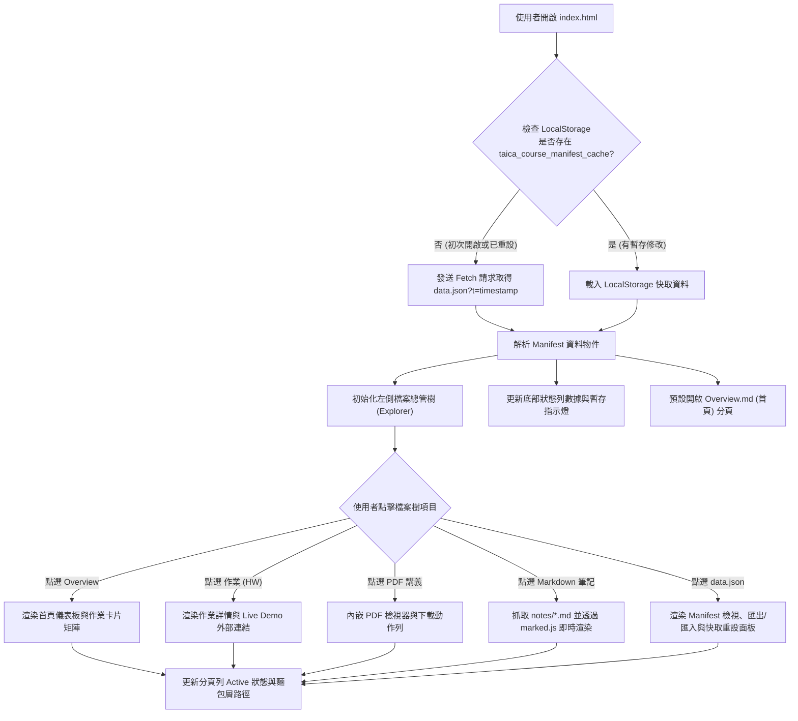
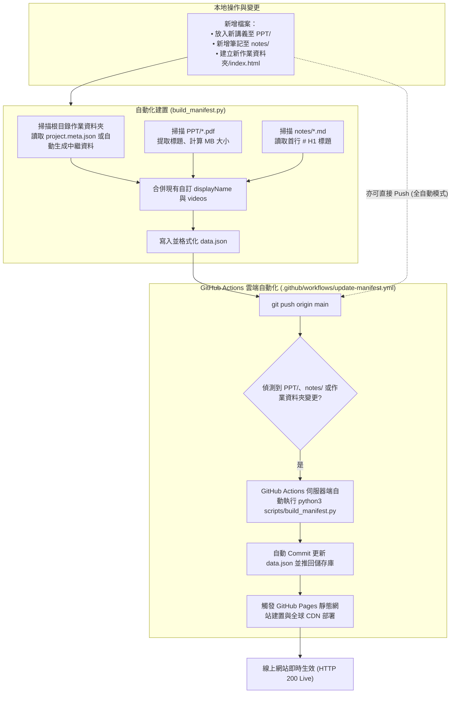
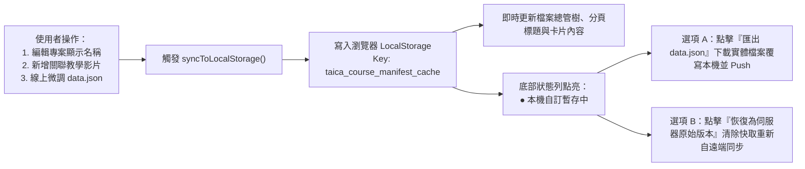

# 課程作業與知識整合中心 — 系統操作指南與架構手冊

> 本文件為國立臺灣科技大學（NTUST）人工智慧所 **115-1《生成式AI：文字與圖像生成的原理與實務》** 課程入口網站與學習知識庫的完整操作說明、運作流程圖與檔案職責手冊。

---

## 📑 目錄
1. [網頁介面結構與功能操作說明](#一網頁介面結構與功能操作說明)
2. [系統架構與運作流程圖 (Mermaid)](#二系統架構與運作流程圖)
   - 2.1 前端動態載入與分頁渲染流程
   - 2.2 內容自動化掃描與 CI/CD 部署流程
   - 2.3 使用者自訂操作與 LocalStorage 持久化流程
3. [核心檔案與目錄職責對照表](#三核心檔案與目錄職責對照表)
4. [常見情境操作指引 (FAQ)](#四常見情境操作指引-faq)

---

## 一、網頁介面結構與功能操作說明

本網站採用 **正統 VS Code Dark+ IDE 工作台版型**，並嚴格遵循 **100% 零透明度實色設計規範**（無任何 `rgba()`、半透明與毛玻璃模糊效果）。整體介面分為五大核心區域：

```
+-----------------------------------------------------------------------------------+
| 1. Title Bar (頂部標題列, 36px)                                                    |
+----+----------------------+-------------------------------------------------------+
| 2. | 3. Explorer Sidebar  | 4. Editor Group (主編輯區)                            |
| A  |    (檔案總管側邊欄,   |   +-------------------------------------------------+ |
| c  |     280px)           |   | Tabs Bar (多樣化分頁標籤列)                     | |
| t  |                      |   +-------------------------------------------------+ |
| i  |  [ 🔍 快速篩選輸入框 ] |   | Breadcrumb Bar (麵包屑路徑導航)                 | |
| v  |  ------------------  |   +-------------------------------------------------+ |
| i  |  📜 Overview.md (首頁)|                                                     | |
| t  |  📁 assignments/     |   [ 動態舞台內容：                                  | |
| y  |  📁 PPT 課程講義/    |     • 首頁概覽 (Overview)                           | |
|    |  📁 筆記與心得/      |     • 作業詳情與獨立開啟按鈕                         | |
| B  |  📁 關聯教學影片/    |     • 內嵌 PDF 講義檢視器                           | |
| a  |  ⚙️ AGENTS.md        |     • Markdown 筆記即時解析渲染 (marked.js)         | |
| r  |  📊 data.json        |     • data.json 視覺化管理與匯出/匯入 ]              | |
|    |                      |                                                     | |
+----+----------------------+-------------------------------------------------------+
| 5. Status Bar (底部狀態列, 24px)                                                   |
+-----------------------------------------------------------------------------------+
```

### 1. 頂部標題列 (Title Bar)
- **課程與學員資訊**：常駐顯示「115-1 生成式AI：文字與圖像生成的原理與實務」與「林宸平 (M11552010) • 臺灣科大人工智慧所」。
- **快速工具捷徑按鈕**：
  - `💾 匯出 data.json`：一鍵將目前網頁上的所有設定（含自訂名稱、影片連結）打包下載為檔案。
  - `⚙️ AGENTS.md`：一鍵開啟 AI 規範與系統設計指引。
  - `🎥 新增影片`：開啟自訂關聯教學影片的對話框。
  - `🔄 重新整理`：快速刷新工作台資料。

### 2. 左側活動列 (Activity Bar, 48px)
- 提供垂直導航圖示：
  - **檔案總管圖示**：切換左側檔案總管展開/收合。
  - **自訂名稱管理圖示**：快速切換至各專案的顯示名稱管理視窗。
  - **影片與筆記工具**：快速呼叫新增影片或開啟筆記。

### 3. 左側檔案總管側邊欄 (Explorer Sidebar, 280px)
- **🔍 即時搜尋過濾列 (Quick Filter)**：
  - 位於側邊欄頂部，支援**毫秒級即時模糊比對**。
  - 輸入關鍵字（如「老闆」、「神經網路」、「HW」、「AGENT」）時，系統立即過濾作業、PDF 講義、Markdown 筆記與影片，並自動展開匹配項目所在的資料夾。
  - 清空搜尋框即刻自動還原完整檔案樹。
- **可折疊階層式檔案樹**：
  - `📜 Overview.md (首頁)`：點擊即回到全課程總覽儀表板。
  - `📁 assignments (課程作業)`：收錄各週作業，支援自訂顯示名稱。
  - `📁 PPT 課程講義`：自動由 `PPT/` 資料夾掃描收錄的所有 PDF 投影片。
  - `📁 筆記與心得`：收錄 `notes/` 下的所有 Markdown 學習筆記。
  - `📁 關聯教學影片`：收錄課程關聯之線上教學或直播錄影。
  - `⚙️ AGENTS.md`：核心規範檔案。
  - `📊 data.json`：全站中繼資料庫。

### 4. 中央主編輯區 (Editor Group)
- **分頁管理系統 (Tabs)**：支援多分頁同時開啟、點擊切換、按 `✕` 關閉分頁，並具備 Active 藍色頂部邊框高亮連動。
- **麵包屑導航 (Breadcrumbs)**：即時顯示當前選取物件的階層路徑（如 `TAICA_IVEAI > PPT 課程講義 > 08教AI做事的方法.pdf`）。
- **多型態動態渲染舞台**：
  - **首頁 Overview 儀表板**：展示課程核心簡介、統計卡片、所有作業快速卡片矩陣、最新更新時間。
  - **作業詳細視窗**：顯示作業徽章、標題、技術標籤、專案描述，並提供 **「🚀 線上體驗 (Live Demo)」** 按鈕以新分頁開啟實體獨立專案。
  - **PDF 講義檢視器**：直接在編輯區內嵌 PDF，並提供「在新分頁開啟完整檢視」與「下載 PDF 檔案」雙按鈕。
  - **Markdown 筆記渲染器**：透過內嵌 `marked.js` 將 Markdown 筆記即時解析為排版優雅的技術文章（支援標題、清單、代碼區塊與引言）。
  - **data.json 資料管理中心**：提供即時 JSON 檢視、直接套用編輯、選擇本機 JSON 檔案匯入、清除快取還原為遠端原始版本。

### 5. 底部狀態列 (Status Bar, 24px)
- **實色藍底 (`#007acc`)**：符合 VS Code 經典狀態列樣式。
- **即時數據監控**：即時統計目前載入的 `作業數 • 講義數 • 筆記數 • 影片數`。
- **本機暫存指示燈**：若瀏覽器 LocalStorage 含有未發布到遠端的自訂暫存修改，會亮起黃色文字 `● 本機自訂暫存中`，點擊可快速開啟管理面板。
- **Git 狀態與時間戳**：顯示當前 Git 分支 `main` 以及最後建置時間戳。

---

## 二、系統架構與運作流程圖

### 2.1 前端動態載入與分頁渲染流程
說明使用者進入網頁時，系統如何判斷快取、發送網路請求並完成動態呈現：



---

### 2.2 內容自動化掃描與 CI/CD 部署流程
說明當使用者新增 PDF 講義、撰寫 Markdown 筆記或建立新作業時，資料庫與網站如何自動同步：



---

### 2.3 使用者自訂操作與 LocalStorage 持久化流程
說明使用者在網頁上編輯專案名稱、新增影片或管理資料時的防掉資料機制：



---

## 三、核心檔案與目錄職責對照表

| 檔案 / 目錄路徑 | 類型 / 技術 | 核心職責與主要功能說明 | 關聯檔案與互動機制 |
| :--- | :--- | :--- | :--- |
| `index.html` | 前端單頁應用 (SPA)<br/>(HTML5 / CSS3 / Vanilla JS) | **全站主入口與 IDE 工作台本體**。<br/>1. 實作 VS Code Dark+ 五大版型結構。<br/>2. 動態讀取 `data.json` 渲染檔案總管樹狀結構。<br/>3. 提供即時搜尋篩選、多分頁標籤管理與麵包屑導航。<br/>4. 內嵌 PDF 檢視器、影片播放器與 Markdown 解析器 (`marked.js`)。<br/>5. 管理本機 LocalStorage 快取與 JSON 雙向匯入/匯出。 | 讀取 `data.json`、`notes/*.md`、`PPT/*.pdf`；透過 LocalStorage 維護自訂修改 |
| `data.json` | 系統資料庫 (Manifest)<br/>(JSON) | **全站資料驅動的中樞資料庫**。<br/>儲存課程元資訊（名稱、學生、學系、最後更新時間）、作業資料夾清單（ID、路徑、標籤、按鈕連結）、教材講義清單（標題、路徑、MB 大小）、Markdown 筆記清單與關聯教學影片。 | 由 `build_manifest.py` 自動生成與維護，供 `index.html` 動態載入 |
| `AGENTS.md` | 架構與設計規範書<br/>(Markdown) | **AI Agent 維護與擴充本專案的最高準則**。<br/>1. 明訂「VS Code Dark+ 零透明度實色標準」（嚴禁 rgba、opacity、blur）。<br/>2. 定義介面尺寸、字型標準與檔案命名規範。<br/>3. 規範 AI 修改或新增作業時的強制工作流程。 | 所有 AI Agent 與協作者進行代碼撰寫與功能擴充的指導準則 |
| `README.md` | 儲存庫導覽說明<br/>(Markdown) | **儲存庫對外展示與導覽總說明**。<br/>收錄全學期作業總表、目錄結構樹、系統特色亮點、更新日誌（Changelog）與外部評分連結。 | 供訪客、評分老師與助教查閱，與遠端 GitHub 首頁同步展示 |
| `scripts/build_manifest.py` | 自動化維護腳本<br/>(Python 3) | **資料庫自動掃描與建置程式**。<br/>1. 自動掃描根目錄新作業資料夾並讀取 `project.meta.json`。<br/>2. 自動掃描 `PPT/` 資料夾中所有 PDF 並精確計算 MB 檔案大小。<br/>3. 自動掃描 `notes/` 提取 Markdown 第一行標題。<br/>4. 保留既有自訂 `displayName` 與 `videos`，產出最新 `data.json`。 | 開發者本地執行，或由 GitHub Actions 在雲端環境自動執行 |
| `.github/workflows/update-manifest.yml` | CI/CD 自動化工作流<br/>(GitHub Actions YAML) | **雲端持續整合與自動發布流水線**。<br/>監聽 `main` 分支推播。每當偵測到講義、筆記或作業更新時，自動在 GitHub 雲端環境執行 `build_manifest.py`，若有產出變更則自動提交並觸發 GitHub Pages 部署。 | 實現「零人工維護」的自動化同步發布 |
| `PPT/` | 靜態資源目錄<br/>(PDF Files) | **課程講義與投影片集中存放處**。<br/>放入新的 `.pdf` 檔案後，自動由建置腳本識別並納入網站「PPT 課程講義」選單。 | 由 `build_manifest.py` 掃描並寫入 `data.json` 的 `materials` |
| `notes/` | 知識庫目錄<br/>(Markdown Files) | **課堂學習與技術筆記集中存放處**。<br/>採用 Markdown 格式撰寫，首行以 `# 標題` 命名，由腳本自動掃描並在網頁中即時解析呈現。 | 由 `build_manifest.py` 掃描並寫入 `data.json` 的 `notes` |
| `建立一個自己的  AGENTS/` | 作業二 / 系統本體<br/>(Meta-Project) | **本次作業成果，同時作為全站架構本體**。<br/>1. `index.html`：作業二實體展示頁。<br/>2. `README.md`：系統架構書與設計規範深度解析。<br/>3. `project.meta.json`：作業二中繼資訊設定檔。 | 既是可獨立評分的作業，也是整個課程入口網站的架構藍本 |
| `用 Vibe Coding 做出一個互動網頁/` | 作業一專案資料夾 | **第一週作業成果**。<br/>包含作業靜態網頁成果與說明檔案，可由主頁點擊按鈕直接開啟獨立體驗。 | 由 `data.json` 的 `assignments` 清單關聯 |
| `Local AI File Agent/` | 課堂實作專案資料夾 | **課堂/期中 AI 檔案處理代理人專案**。<br/>包含 Python 後端伺服器、CLI 工具與前端介面。 | 課堂實作展示成果 |
| `Messenger for IG/` | 課堂實作專案資料夾 | **Instagram 訊息與社群代理人實作專案**。 | 課堂實作展示成果 |
| `.gitignore` | Git 版本控制配置 | 排除非必要檔案（如 `.DS_Store`、暫存檔案等），保持倉庫乾淨。 | Git 追蹤控制 |

---

## 四、常見情境操作指引 (FAQ)

### Q1：我新增了新的 PDF 講義到 `PPT/`，該怎麼讓網頁更新？
- **最快方式**：在本地終端機執行：
  ```bash
  python3 scripts/build_manifest.py
  git add PPT/ data.json
  git commit -m "feat: 新增上課講義"
  git push origin main
  ```
- **懶人方式**：直接把 PDF 檔案 commit 並 push 到 GitHub，GitHub Actions 會在雲端自動執行腳本並重新發布網站。

### Q2：我新增了一篇 Markdown 筆記，該放在哪裡？
- 請在 `notes/` 資料夾下新增 `.md` 檔案，建議檔名格式為 `W{週次}_{主題名稱}.md`。
- 檔案第一行請務必使用一級標題 `# 你的筆記標題`。
- 儲存後執行 `python3 scripts/build_manifest.py` 並推播至 GitHub 即可在側邊欄看到該筆記。

### Q3：我想為某項作業改名，但不想動實體資料夾名稱，該怎麼做？
- 在網頁上點選左側活動列的「管理專案名稱」圖示，或在作業詳情中點選「編輯顯示名稱」，輸入後儲存即可。
- 儲存後點擊頂部「💾 匯出 data.json」，將下載的 `data.json` 覆寫根目錄的 `data.json` 並推送到 GitHub，即可對所有訪客永久生效。

### Q4：網頁底部顯示「● 本機自訂暫存中」，是什麼意思？
- 表示您曾經在網頁上編輯過專案名稱、新增過影片或編輯過 `data.json`，瀏覽器目前優先載入您本機修改的版本。
- 若您想放棄本機修改並同步遠端最新的內容，請點擊側邊欄的 `data.json`，進入後點擊 **「恢復為伺服器原始版本」** 按鈕即可重設。

