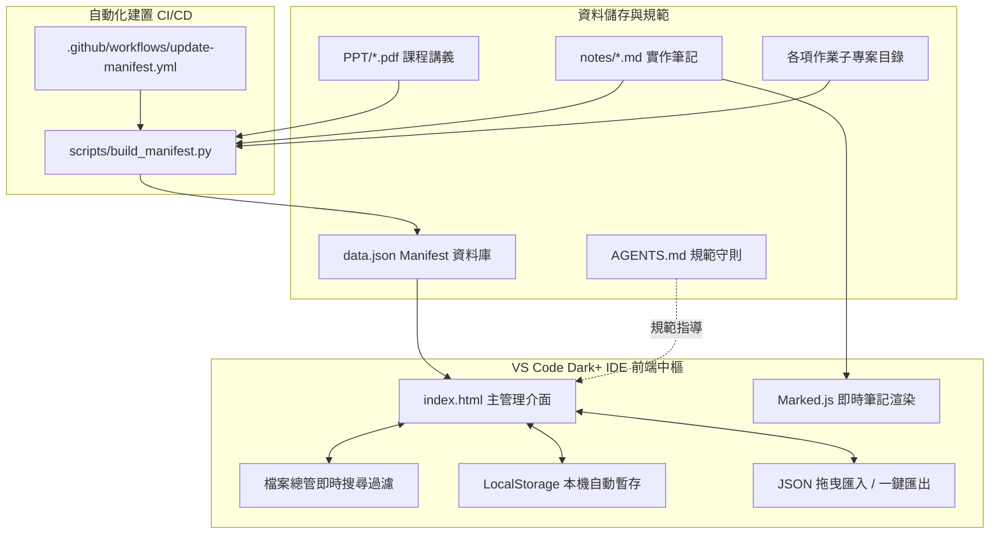

# 作業二：建立一個自己的 AGENTS.md (HW 2) — 全站課程管理中樞

> **課程名稱**：115-1 生成式AI：文字與圖像生成的原理與實務 (TAICA_IVEAI)  
> **學號**：M11552010  
> **學生**：國立臺灣科技大學 人工智慧所 林宸平  
> **全站主入口**：👉 **[https://philiplin0211.github.io/115_1_TAICA_IVEAI/](https://philiplin0211.github.io/115_1_TAICA_IVEAI/)**  
> **開發規範手冊**：👉 **[專案根目錄 AGENTS.md](../AGENTS.md)**  
> **學習與架構筆記**：👉 **[W08 設計筆記](../notes/W08_AGENTS_md_設計筆記.md)**

---

## 🌟 作業核心定位：從單次作業升級為全站基礎設施 (Meta-Project Infrastructure)

本作業不僅僅是單一網頁的切版實作，而是為整個學期的課程作業、文獻講義與實作筆記打造一個**高可用、工程級、資料驅動的 VS Code Dark+ IDE 管理中樞**：



---

## 📌 核心技術亮點

### 1. 嚴格遵循 VS Code Dark+ 零透明度實色標準 (Solid Colors Standard)
全站 CSS 徹底拔除所有 `rgba()`、半透明漸層與 `backdrop-filter: blur()`，100% 採用純實色系統，重現專業工程師熟悉的 VS Code Dark+ 視覺體驗。

| 變數名稱 | 實色色碼 (Hex) | 用途與說明 |
| :--- | :--- | :--- |
| `--bg-editor` | `#1e1e1e` | 主內容區與編輯視窗背景 |
| `--bg-sidebar` | `#252526` | 檔案總管側邊欄與主要卡片背景 |
| `--bg-activity` | `#333333` | 最左側活動列背景 |
| `--bg-tabs` | `#2d2d2d` | 頂部分頁列與標題列底色 |
| `--bg-statusbar` | `#007acc` | 底部狀態列底色 (VS Code 標誌藍) |
| `--border-solid` | `#3c3c3c` | 全站實色邊框 |
| `--text-bright` | `#ffffff` | 高亮標題文字 |
| `--text-main` | `#cccccc` | 內文標準文字 |
| `--text-muted` | `#858585` | 次要說明與路徑文字 |
| `--accent-blue` | `#569cd6` | 主要藍色連結與麵包屑 |
| `--accent-teal` | `#4ec9b0` | 代碼註釋與語意高亮色 |
| `--accent-orange`| `#ce9178` | 副標題與行內代碼色 |
| `--accent-yellow`| `#dcdcaa` | 警告與本地暫存指示色 |

### 2. 具備真正管理能力的互動功能 (Data Management Suite)
- **檔案總管即時搜尋過濾 (Quick Filter)**：輸入關鍵字，毫秒級動態篩選作業、講義與筆記，並自動展開對應分類資料夾。
- **LocalStorage 即時自動暫存**：在網頁上自訂專案顯示名稱（`displayName`）、新增影片連結或撰寫筆記時，自動同步至瀏覽器 LocalStorage，重新整理絕不遺失。
- **一鍵匯入／匯出 Manifest**：支援點擊下載最新 `data.json`，亦支援選取或拖曳上傳 JSON 設定檔快速恢復。
- **Marked.js 即時 Markdown 筆記渲染**：隨時點選即在編輯器內呈現排版工整之學習筆記或 `AGENTS.md` 規範全文。

### 3. GitHub Actions CI/CD 自動化守護
- 每當推送新的講義 PDF 至 `PPT/`、新的 `.md` 至 `notes/`，或建立新作業資料夾時，GitHub Actions 自動執行 `python3 scripts/build_manifest.py`。
- 腳本自動解析 PDF 檔案大小、萃取 Markdown 首行標題、讀取作業 `project.meta.json`，並自動 commit 更新 `data.json`，達成 **100% 零手動維護**。

---

## 📂 檔案目錄結構

```text
建立一個自己的  AGENTS/
├── index.html           # 作業二架構展示子頁面 (VS Code Dark+ 零透明度風格)
├── project.meta.json    # 作業中繼描述檔 (供 build_manifest.py 自動解析)
└── README.md            # 作業二詳細技術規格與架構說明書 (本文件)
```

---

> 國立臺灣科技大學 人工智慧所 M11552010 林宸平  
> 115-1 生成式AI：文字與圖像生成的原理與實務
